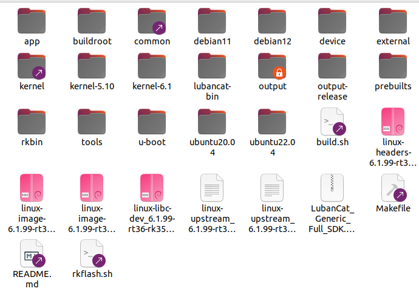
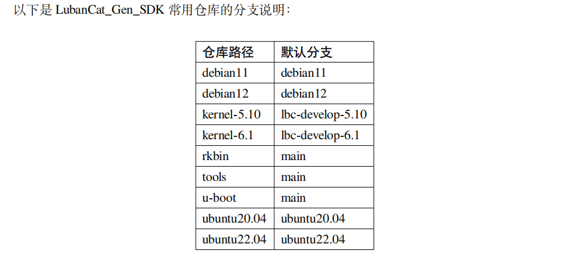
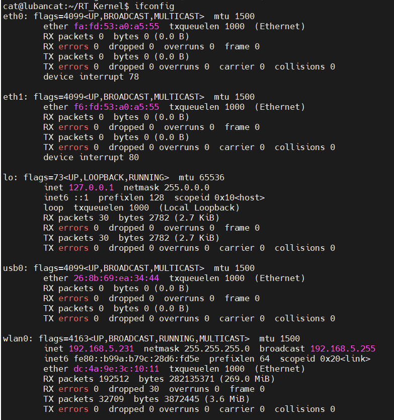
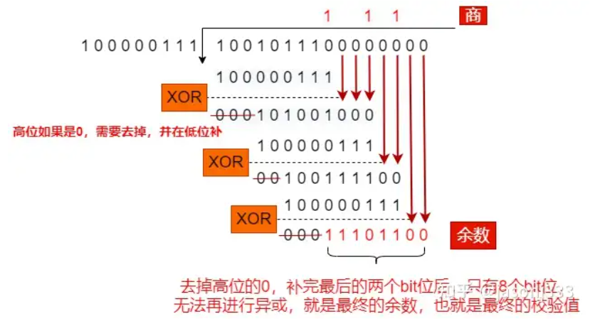
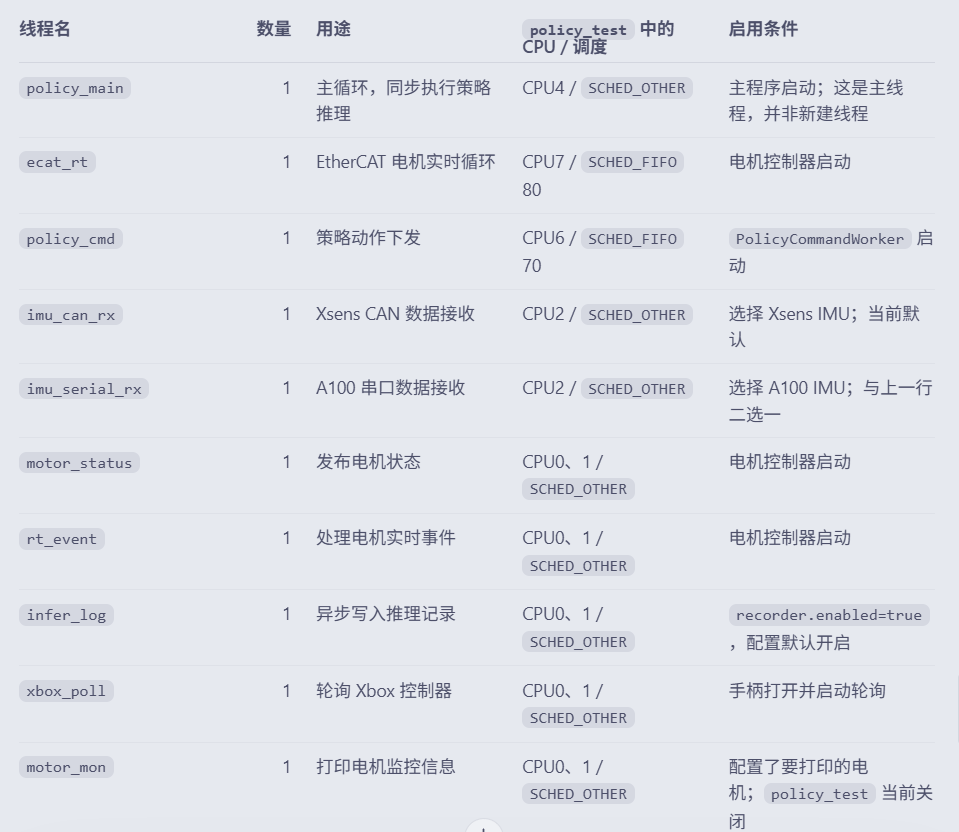
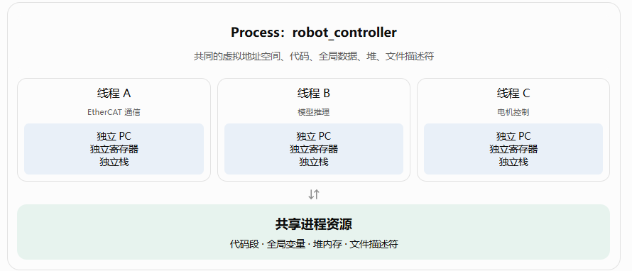
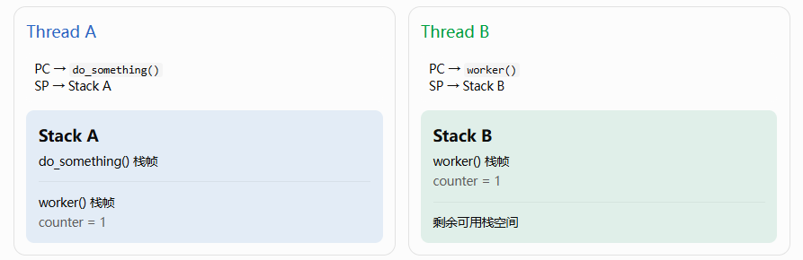
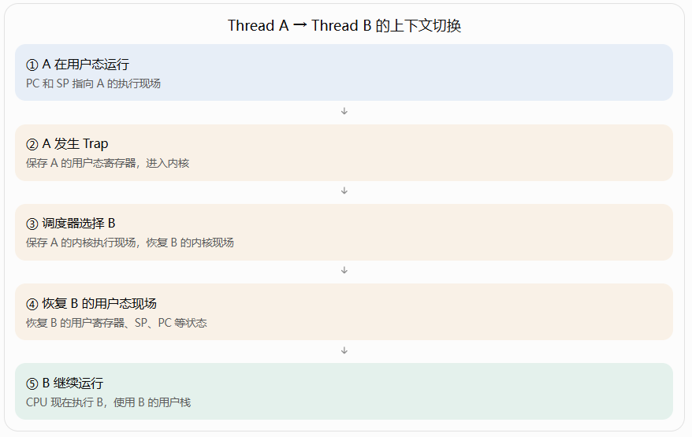
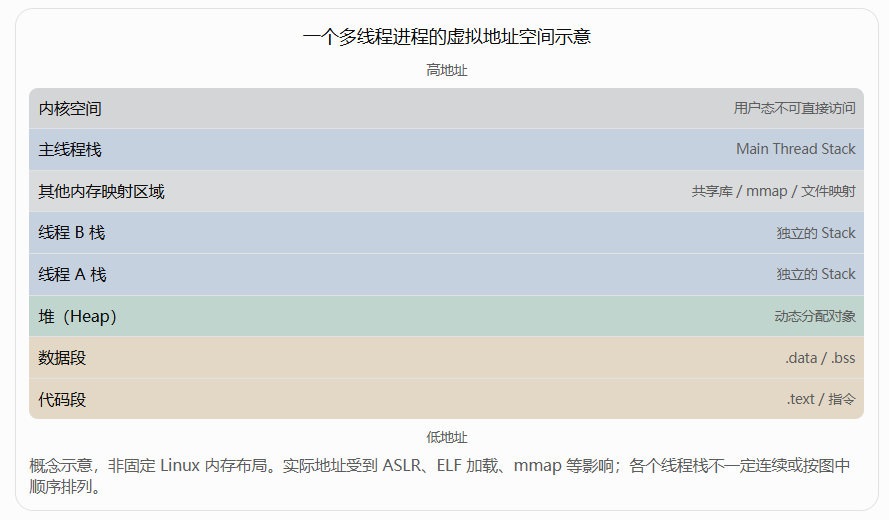

```json
{
  "http.proxy": "http://127.0.0.1:7900",
  "http.proxySupport": "override",
  "http.proxyStrictSSL": false,
  "http.noProxy": ["127.0.0.1", "localhost", "::1"]
}
```
# 重构内核

## 卸载原内核

``` bash
dpkg --list | grep -E "linux-image-[0-9]|linux-headers-[0-9]|linux-modules-[0-9]"

hi  linux-headers-5.10.209-rk3588   5.10.209-rk3588-4    arm64        Linux kernel headers for 5.10.209-rk3588 on arm64
hi  linux-image-5.10.209-rk3588     5.10.209-rk3588-4    arm64        Linux kernel, version 5.10.209-rk3588

sudo apt remove linux-headers-6.1.99-rk3588 linux-image-6.1.99-rk3588
```

## 构建新内核

 [野火\]嵌入式Linux镜像构建与部署——基于LubanCat-RK系列板卡 文档 (embedfire.com)](https://doc.embedfire.com/linux/rk356x/build_and_deploy/zh/latest/building_image/lubancat_sdk/lubancat_gen_sdk.html)



### 添加实时补丁

RT-Linux 的核心是 Linux 内核的一个实时扩展，它为实时任务提供了必要的调度机制和时间管理。通过采用抢占式调度策略，高优先级的实时任务可以打断低优先级的任务，确保实时任务能够及时响应。RT-Linux 对任务的调度和中断处理进行了改进，使得任务能够按照预定的时间要求执行。

与传统的 Linux 内核相比，RT-Linux 在实时性能方面有所提升，但它**并不是一个硬实时系统**，无法保证任务的执行时间绝对精确。对于对时间要求极高的应用，可能需要采用更专门的实时操作系统。

#### 获取纯净内核与补丁

[LubanCat/kernel: LubanCat-RK BSP kernel source (github.com)](https://github.com/LubanCat/kernel/tree/lbc-develop-6.1)



``` shell
# 打好补丁的内核
git clone --depth=1 -b lbc-develop-6.1-rt36 https://github.com/LubanCat/kernel.git kernel-6.1

# 纯净内核
git clone --depth=1 -b lbc-develop-6.1 https://github.com/LubanCat/kernel.git kernel-6.1
```

---

查看内核版本：

``` shell
make kernelversion
```

下载实时补丁：[Index of /pub/linux/kernel/projects/rt/6.1/older/](https://mirrors.edge.kernel.org/pub/linux/kernel/projects/rt/6.1/older/)

``` shell
# 进入纯净内核目录
cd 野火SDK路径/linux-sdk/kernel-6.1/
# 解压补丁
gzip -d patch-6.1.99-rt36.patch.gz
```

打补丁：

```shell
# 在纯净内核根目录执行（必须加-p1）
patch -p1 < patch-6.1.xx-rt36.patch

--- a/kernel/sched/core.c	2024-01-01 00:00:00
+++ b/kernel/sched/core.c	2024-01-01 00:00:00
```

#### 解决冲突文件

查找冲突文件：

``` shell
find . -name "*.rej"
```

冲突文件示例：

``` c
--- drivers/tty/serial/8250/8250.h
+++ drivers/tty/serial/8250/8250.h
// 从176行开始的12行->改为49行
@@ -176,12 +176,49 @@ static inline void serial_dl_write(struct uart_8250_port *up, int value)
 	up->dl_write(up, value);
 }
 
+static inline int serial8250_in_IER(struct uart_8250_port *up)
+{
+	struct uart_port *port = &up->port;
+	unsigned long flags;
+	bool is_console;
+	int ier;
+
+	is_console = uart_console(port);
+
+	if (is_console)
+		printk_cpu_sync_get_irqsave(flags);
+
+	ier = serial_in(up, UART_IER);
+
+	if (is_console)
+		printk_cpu_sync_put_irqrestore(flags);
+
+	return ier;
+}
+
+static inline void serial8250_set_IER(struct uart_8250_port *up, int ier)
+{
+	struct uart_port *port = &up->port;
+	unsigned long flags;
+	bool is_console;
+
+	is_console = uart_console(port);
+
+	if (is_console)
+		printk_cpu_sync_get_irqsave(flags);
+
+	serial_out(up, UART_IER, ier);
+
+	if (is_console)
+		printk_cpu_sync_put_irqrestore(flags);
+}
+
 static inline bool serial8250_set_THRI(struct uart_8250_port *up)
 {
 	if (up->ier & UART_IER_THRI)
 		return false;
 	up->ier |= UART_IER_THRI;
-	serial_out(up, UART_IER, up->ier);
+	serial8250_set_IER(up, up->ier);
 	return true;
 }
 
@@ -190,7 +227,7 @@ static inline bool serial8250_clear_THRI(struct uart_8250_port *up)
 	if (!(up->ier & UART_IER_THRI))
 		return false;
 	up->ier &= ~UART_IER_THRI;
-	serial_out(up, UART_IER, up->ier);
+	serial8250_set_IER(up, up->ier);
 	return true;
 }
 

```

#### 测试实时性

``` shell
# 安装工具
apt install -y python git

# 下载 cyclictest 的源码
git clone https://github.com/jlelli/rt-tests.git

# 进入源码目录
cd rt-tests

# 编译源码（如果有报错，应该是依赖没弄好，根据缺失的依赖安装即可）
make -j4
```

使用**cyclictest**工具进行测试，明确参数含义：

| 参数        | 含义                                                         | 对应你的测试场景                                             |
| ----------- | ------------------------------------------------------------ | ------------------------------------------------------------ |
| `-p 99`     | 设置测试线程的 SCHED_FIFO 实时优先级为 99（Linux 最高实时优先级） | 模拟 EtherCAT 主站线程的最高优先级调度                       |
| `-m`        | 锁定测试线程的内存，禁止 swap 交换到磁盘                     | 避免内存换入换出带来的延迟抖动，和 EtherCAT 工程最佳实践一致 |
| `-n`        | 使用`nanosleep`高精度纳秒级计时                              | 适配工业控制微秒级的实时精度要求                             |
| `-i 1000`   | 线程唤醒间隔为 1000us（1ms）                                 | 完全匹配 EtherCAT 最常用的 1ms 通信周期                      |
| `-l 100000` | 总计循环测试 10 万次                                         | 测试总时长约 100 秒，你当前截图是测试中途的结果              |
| `sudo`      | root 权限执行                                                | 只有 root 才能设置最高实时优先级，操作正确                   |

``` shell
sudo ./cyclictest -p 99 -m -n -i 1000 -l 100000
```

`cyclictest` 延迟 > 200μs → 通信易超时。

### 支持EtherCAT

#### 编译模块

``` shell
# 进入 ethercat_igh 目录
cd external/ethercat_igh

# 导出编译器路径到环境变量
 export PATH=/home/dev/LubanCat_Linux_SDK/prebuilts/gcc/linux-x86/aarch64/gcc-arm-10.3-2021.07-x86_64-aarch64-none-linux-gnu/bin:$PATH

 # 初始化构建环境
./bootstrap
./configure --prefix=/home/dev/LubanCat_Linux_SDK/external/ethercat_igh/output --host=aarch64-none-linux-gnu --with-linux-dir=/home/dev/LubanCat_Linux_SDK/kernel-6.1 --enable-8139too=no --enable-stmmac=yes --enable-generic=no --enable-wildcards=yes

# 编译
make -j8

# 将编译生成的内容安装到 output 目录
make install systemdsystemunitdir=/home/dev/LubanCat_Linux_SDK/external/ethercat_igh/output

# 编译内核外部模块
make modules ARCH=arm64 CROSS_COMPILE=aarch64-none-linux-gnu- -C /home/dev/LubanCat_Linux_SDK/kernel-6.1 M=$PWD -j3
```

编译生成的用户态文件保存在 ethercat_igh 的 `output` 目录下，生成的 `ko` 模块文件保存在 `master/ec_master.ko` 和`devices/stmmac/ec_stmmac.ko`。

## 安装新内核

``` shell
sudo dpkg -i linux-image-6.1.99-rt36-rk3588_*_arm64.deb
sudo dpkg -i linux-headers-6.1.99-rt36-rk3588_*_arm64.deb
```

# 脉塔电机

## EtherCAT

### 加载驱动

两个模块均来自**IgH EtherCAT Master**（Linux 系统下最主流的开源 EtherCAT 主站实现，广泛用于工业自动化、机器人运动控制等实时控制场景）：

1. `ec_master.ko`：EtherCAT 主站的**核心内核模块**。

   是整个 EtherCAT 协议栈的核心载体，负责 EtherCAT 总线拓扑管理、从站设备配置、PDO 过程数据 / SDO 邮箱通信、分布式时钟 DC 同步、数据帧封装与解析、总线状态机管理等核心功能，同时为用户态应用提供标准的控制接口（`/dev/EtherCATx`）。

2. `ec_stmmac.ko`：EtherCAT 主站针对 stmmac 网卡的**专用实时驱动模块**。

   stmmac 是 Synopsys DesignWare 系列以太网 MAC 控制器的标准驱动，广泛用于瑞芯微 RK 系列、STM32MP1、NXP i.MX 等 ARM 嵌入式平台。该模块是为 EtherCAT 深度优化的专用驱动，替代 Linux 标准网络栈，直接对接网卡硬件，为 ec_master 提供低延迟、低抖动的帧收发能力，相比通用驱动能大幅提升 EtherCAT 通信的实时性。

#### 手动加载



``` shell
# 完好铜柱
sudo insmod ec_master.ko main_devices=fa:fd:53:a0:a5:55

sudo insmod ec_master.ko main_devices=46:ff:1d:47:0f:c7
sudo insmod ec_stmmac.ko
```

#### 自动加载

首先**安装模块到系统内核目录，更新依赖数据库**：

``` shell
# 创建专用的模块存放目录
sudo mkdir -p /lib/modules/$(uname -r)/extra/ethercat/

# 将两个.ko模块文件复制到系统内核模块目录
sudo cp ec_master.ko ec_stmmac.ko /lib/modules/$(uname -r)/extra/ethercat/

# 更新内核模块依赖数据库，让系统识别模块和依赖关系
sudo depmod -a
```

然后配置模块固定启动参数：

**创建模块参数配置文件**，让系统每次加载 ec_master 时，自动带上指定的 MAC 地址参数：

``` shell
# 创建并编辑参数配置文件
sudo nano /etc/modprobe.d/ethercat.conf
```

在文件中写入以下内容，保存退出：

``` shell
options ec_master main_devices=fa:fd:53:a0:a5:55
```

---

其次配置开机自动加载，固定加载顺序：

**创建 systemd 开机加载配置文件，按正确顺序**指定要自动加载的模块：

``` shell
# 创建并编辑开机加载配置文件
sudo nano /etc/modules-load.d/ethercat.conf
```

在文件中按顺序写入模块名，保存退出：

``` shell
ec_master
ec_stmmac
```

验证配置有效性：

``` shell
# 手动触发systemd模块加载服务，测试配置是否正常
sudo systemctl restart systemd-modules-load.service

# 验证模块是否成功加载
lsmod | grep ec_

# 查看模块加载日志，确认无报错
dmesg | grep EtherCAT
```

验证无报错后，重启系统，再次执行`lsmod | grep ec_`，即可确认模块已开机自动加载。

#### 修改设备权限


Linux 的 `/dev` 目录是**临时文件系统（tmpfs）**，**关机 / 重启后会清空**，所有设备节点（包括 `/dev/EtherCAT0`）会重新生成。

**驱动视角**：在 Linux 驱动中，硬件通常被抽象为三种：字符设备（按字节流访问，如串口、鼠标）、块设备（按数据块访问，如硬盘、U盘）和网络设备（不通过 /dev，走 Socket）。**当驱动程序向内核注册一个字符或块设备时，系统会在 `/dev` 下创建一个对应的文件**（例如 `/dev/ttyS0` 代表串口，`/dev/sda` 代表硬盘），应用程序通过标准的 C 语言文件 I/O 函数（`open、read、write、ioctl`）来操作这些文件。

---

查看命令权限：

``` shell
ls -l $(which ethercat)
```

修改权限：

``` shell
sudo nano /etc/udev/rules.d/99-ethercat.rules
# 输入：？
SUBSYSTEM=="ethercat", GROUP="users", MODE="0666"

# 重载udev规则
sudo udevadm control --reload-rules
# 触发规则生效
sudo udevadm trigger
```

### 安装`<ecrt.h>`库

``` shell
# 安装依赖
sudo apt update && sudo apt install linux-headers-$(uname -r) build-essential automake autoconf libtool

# 下载源码（替换为最新版本）
git clone https://gitlab.com/etherlab.org/ethercat.git
cd ethercat
./bootstrap
./configure --prefix=/opt/etherlab --enable-generic --enable-8139too
make -j$(nproc)
sudo make install
```

安装后，头文件默认路径为 `/opt/etherlab/include`，库文件为 `/opt/etherlab/lib`。

### `<ecrt.h>`库开发

该头文件仅归属于 `IgH EtherCAT Master` 开源主站，SOEM 等其他 EtherCAT 主站方案不使用该头文件。

#### 申请主站

在这个阶段，要告诉系统：我要用哪个主站？我要建几个域？网络里有哪些从站？它们各自需要交换什么数据？

---

首先需要请求并独占一个 `EtherCAT` 主站实例：

``` c++
//参数： master_index 通常为 0（代表申请系统中的第一个主站 eth0）。
//返回： ec_master_t* 主站句柄。

ec_master_t* ecrt_request_master(unsigned int master_index);
```

**一张物理网卡在同一时刻只能被一个 IgH EtherCAT 主站实例占用，但一个主站可以关联多张网卡**。

#### 创建数据域

然后在指定的 EtherCAT 主站 `master` 下创建一个新的**过程数据域**（process data domain；不是PDO，PDO是Process Data Object，过程数据对象），并返回对应的 `ec_domain_t*` 句柄。过程数据域**是一块连续的内存区域**，它将分散在各个从站的 `PDO`（其实是`PDO entry`） 聚合到主站的一块连续内存中。数据域**用于合并多个从站的数据**，以便用一个以太网帧进行交换：

``` c++
// 该函数会分配内存
ec_domain_t* ecrt_master_create_domain(ec_master_t *master);
```

它是：一组需要周期性交换的 PDO 数据，以及为了交换这些数据所建立的过程映像、FMMU 配置、EtherCAT datagram 和 Working Counter 状态的管理对象。IgH 内部的 `ec_domain` 包含：

- 所属的 `ec_master_t*`；
- **过程数据的大小，内存指针**；用于过程数据交换的 datagram；
- FMMU 配置，逻辑地址；
- 实际和期望 Working Counter。

可以把它想象成一个“周期通信数据包组”，假设控制两个伺服电机，每个电机交换以下数据：

``` c++
RxPDO：主站 → 从站
├── Control Word       2 字节
└── Target Position    4 字节

TxPDO：从站 → 主站
├── Status Word        2 字节
└── Actual Position    4 字节  
```

两个电机合起来，应用程序最终会看到类似这样的内存：

``` text
domain_pd
│
├── offset 0：Motor 1 Control Word
├── offset 2：Motor 1 Target Position
├── offset 6：Motor 1 Status Word
├── offset 8：Motor 1 Actual Position
├── offset 12：Motor 2 Control Word
├── offset 14：Motor 2 Target Position
├── offset 18：Motor 2 Status Word
└── offset 20：Motor 2 Actual Position
```

##### 分配内存地址

使用`uint8_t* domain_pd`指向 Domain 的一片过程数据内存。应用程序通过偏移量读取、写入：

``` c++
if(ecrt_master_activate(master))
{
    std::cerr << "激活主站失败\n";
    return false;
}

uint8_t *ecrt_domain_data(ec_domain_t *domain ;
domain1_pd = ecrt_domain_data(domain1));


/* 这些映射偏移量通过ecrt_domain_reg_pdo_entry_list()配置 */
uint16_t status_word = EC_READ_U16(domain_pd + offset_status_word);

int32_t actual_position = EC_READ_S32(domain_pd + offset_actual_position);

EC_WRITE_U16(domain_pd + offset_control_word, control_word);

EC_WRITE_S32(domain_pd + offset_target_position, target_position);
```

所以，Domain 的核心用途就是把分布在多个 EtherCAT 从站中的 PDO 数据映射为应用程序能够直接访问的一片过程数据内存。

#### 创建从站配置句柄

创建**指定主站**上**指定物理ID**对应的从站的配置句柄。它的作用不是“立刻向从站发送配置”，而是：

> 在 Master 内为指定从站获取或创建一个 `ec_slave_config_t` 对象，后续所有 PDO、DC、SDO 和状态查询都通过这个对象完成。

官方文档说明，若同一 `alias + position` 的配置对象已经存在，则会复用；若 Vendor ID 或 Product Code 不一致，则返回错误。该函数需要在主站激活前的非实时阶段调用。

后续通过`alias + position + vendor_id + product_code`在这个主站中找到这个对应的`ec_slave_config_t`。

``` c++
// 返回： ec_slave_config_t* 从站配置句柄。
ec_slave_config_t* ecrt_master_slave_config( ec_master_t *master,	// 主站
                                            
                                             uint16_t alias,		// 别名(一般为 0，依赖物理ID顺序)
                                             uint16_t position,		// 物理ID
                                             uint32_t vendor_id,	// 厂商ID
                                             uint32_t product_code);// 产品代码

// 具体应用实现
std::array<ec_slave_config_t *, kNumSlaves> sc = {};

for (std::size_t i = 0; i < kNumSlaves; i++) 
{   
    /*...*/
    const uint16_t position = kSlavePositions[i];
    sc[i] = ecrt_master_slave_config(master, 0, position, VID_PID);
    /*...*/
}
```

#### 配置从站（协议格式）

**注意这里PDO还没有在domain的内存位置中完成分配！~**

##### 从站对象字典

从站对象字典（Object Dictionary，OD）可以理解成从站对外提供的一张**变量说明表和逻辑地址表**。一个电机的对象字典中可能有：

``` c++
索引:子索引     名称                        类型
0x6040:00      Control Word               uint16
0x6041:00      Status Word                uint16
0x607A:00      Target Position            int32
0x6064:00      Actual Position            int32
0x60FF:00      Target Velocity            int32
0x606C:00      Actual Velocity            int32
0x6060:00      Mode of Operation          int8
0x6061:00      Mode Display               int8
0x1601         RxPDO Mapping Object
0x1A00         TxPDO Mapping Object

// 其中：0x6040:00 不是 Linux 内存地址，也不是网卡地址，而是这个变量在 CoE 对象字典中的逻辑编号。
```

从站的真实固件内部可能把这些对象存储在 RAM、寄存器或内部变量中，对象字典并不要求它们在物理内存中按照索引连续排列。**它是一个通信层面的逻辑访问模型**。IgH 的 PDO Entry 描述也明确使用对象字典的 Index、Subindex 和 Bit Length 来标识待映射变量。

因此本例程的完整的从站对象字典结构相当于：

``` c++
// 0x1601 是“包”；
// 0x6040 是“包里的字段”。

0x1601：RxPDO Mapping Object
├── Entry 1 → 0x6040:00
├── Entry 2 → 0x607A:00
├── ...
└── Entry 8

0x1A00：TxPDO Mapping Object
├── Entry 1 → 0x6041:00
├── Entry 2 → 0x6064:00
├── ...
└── Entry 7
```

**对象字典不是过程数据内存**，过程数据内存 = 从对象字典中选出少数实时变量，按顺序紧凑排列。

---

##### `ecrt_slave_config_pdos()`

为了配置从站要交互什么数据，IgH 使用了三层嵌套的结构体，从微观到宏观依次是：`PDO Entry -> PDO -> Sync Manager`，最终将最顶层的 `ec_sync_info_t` 数组传给 `ecrt_slave_config_pdos()` 函数。

- 这里**配置从站配置句柄**；

``` c++
int ecrt_slave_config_pdos( ec_slave_config_t* sc,
  							unsigned int n_syncs,
    						const ec_sync_info_t syncs[]
);
```

它的作用是：根据 `ec_sync_info_t` 中描述的 Sync Manager、PDO Assignment 和 PDO 映射，为**这个从站**设置完整的 PDO 配置。该函数实际上是多个底层配置函数的便捷封装，包括：

- 配置 Sync Manager；
- 清除和增加 PDO Assignment；
- 清除和增加 PDO 映射；
- 配置每个 PDO Entry 的索引、子索引和位长度。

---

##### `ec_sync_info_t`

这里**配置`sync`通道**，定义：

- 从`ec_pdo_info_t`**数组哪里开始**的**多少个** PDO 分配给这个Sync Manager；
- 数据方向；
- Watchdog 模式。

``` c++
/** 同步管理器配置信息
 *
 * 该结构体可用于配置多个同步管理器，包含PDO分配与PDO映射功能。
 * 在函数 ecrt_slave_config_pdos() 中作为入参类型使用。
 */

typedef struct {
    uint8_t index; 		 /* 同步管理器索引。有效值必须小于宏 #EC_MAX_SYNC_MANAGERS；
                     			 也可设置为 0xff 用于标记列表末尾。 */
    ec_direction_t dir;  /* 同步管理器数据方向。 */
    
    unsigned int n_pdos; /* PDO 数组内 多少个 PDO 分配给这个 sync manager */
    ec_pdo_info_t *pdos; /* 待分配 PDO 数组 */
    
    ec_watchdog_mode_t watchdog_mode; /* 看门狗工作模式。 */
} ec_sync_info_t;
```

应用示例：

``` c++
ec_sync_info_t EthercatAdapterIGH::device_syncs[] = {
    {0, EC_DIR_OUTPUT, 0, NULL, EC_WD_DISABLE},
    {1, EC_DIR_INPUT,  0, NULL, EC_WD_DISABLE},
    {2, EC_DIR_OUTPUT, 1, &EthercatAdapterIGH::device_pdos[0], EC_WD_ENABLE},
    {3, EC_DIR_INPUT,  1, &EthercatAdapterIGH::device_pdos[1], EC_WD_DISABLE},
    {0xff, EC_DIR_INVALID, 0, nullptr, EC_WD_DEFAULT}
};  
```

##### `ec_pdo_info_t`

这里**配置PDO的信息**，定义：

- PDO的从站对象字典中的 **PDO索引**；

- 从`ec_pdo_enry_info_t`**数组哪里开始**的**多少个** Entry 属于这个 PDO；

``` c++
/** PDO 配置信息
 *
 * 该数据类型为 ec_sync_info_t 结构体中 pdos 成员的类型。
 *
 * 参考函数 ecrt_slave_config_pdos()。
 */
typedef struct {
    uint16_t index; 		/* PDO 索引(帧索引) */
    
    unsigned int n_entries; /* 需要进行映射的 PDO Entry数量。数值为 0 代表使用从站默认映射配置
                              （该方式仅在总线配置阶段从站在线时可用） */
    
    ec_pdo_entry_info_t *entries; /* 待映射的 PDO Entry数组。可以为空指针 NULL，
                                    若非空，则数组至少包含 n_entries 个条目信息。 */
} ec_pdo_info_t;
```

应用示例：

``` c++
ec_pdo_info_t EthercatAdapterIGH::device_pdos[] = {
    // RX 主站发送
    {0x1601, 8, &EthercatAdapterIGH::device_pdo_entries[0]},
    // TX 主站接收
    {0x1a00, 7, &EthercatAdapterIGH::device_pdo_entries[8]},
};
```

##### `ec_pdo_entry_info_t`

这里才真正定义：

- Entry 的顺序，index 和 subindex；
- 每个 Entry 有多少 bit；

``` c++
/** PDO条目配置信息
 *
 * 该数据类型是 ec_pdo_info_t 结构体中 entries 成员对应的类型。
 *
 * 参考函数 ecrt_slave_config_pdos()。
 */
typedef struct { 
    uint16_t index;      /**< PDO条目的对象字典索引。 */
    uint8_t  subindex;   /**< PDO条目的对象字典子索引。 */
    uint8_t  bit_length; /**< PDO条目的数据长度，单位：比特。 */
} ec_pdo_entry_info_t;
```

应用示例：

``` c++
// ---定义静态配置模板---
ec_pdo_entry_info_t EthercatAdapterIGH::device_pdo_entries[] = {
    {0x6040, 0x00, 16},  // 控制字
    {0x607a, 0x00, 32},  // 目标位置
    {0x60ff, 0x00, 32},  // 目标转速
    {0x6071, 0x00, 16},  // 目标扭矩
    {0x2000, 0x00, 32},  // PVT_KP
    {0x2001, 0x00, 32},  // PVT_KD
    {0x6060, 0x00, 8},   // 设置运行模式
    {0x2ffd, 0x00, 8},   // 填充字节
    /* ========== RxPDO (主站从从站接收) ========== */
    {0x6041, 0x00, 16},   // 状态字
    {0x6064, 0x00, 32},   // 实际位置
    {0x606c, 0x00, 32},   // 实际转速
    {0x6077, 0x00, 16},  // 实际扭矩
    {0x603f, 0x00, 16},  // 错误码
    {0x6061, 0x00, 8},   // 运行模式
    {0x2ffe, 0x00, 8},   // 填充字节
};
```

##### 什么时候告诉从站

在完成配置并调用：

```c
int ecrt_master_activate(ec_master_t *master);
```

之后，IgH 主站会运行从站配置状态机。该状态机包含明确的：

```
PDO_CONF
PDO_SYNC
FMMU
DC
SAFEOP
OP
```

等阶段，其中 `PDO_CONF` 负责 PDO 配置，`PDO_SYNC` 负责配置过程数据 Sync Manager，随后还会写入 FMMU 配置。

IgH 内部还存在专门的 PDO 配置状态机：

```
ec_fsm_pdo
```

它使用 CoE 状态机和 SDO 请求与物理从站交互，并保存“期望 PDO 配置”与“从站实际出现的 PDO 配置”。

所以完整过程是：

```
用户代码描述 PDO
        ↓
ecrt_slave_config_pdos()
        ↓
配置暂存在主站的 ec_slave_config_t
        ↓
Master 激活并开始配置从站
        ↓
通过 EtherCAT 邮箱 / CoE SDO 写入从站
        ↓
从站获得 PDO Mapping 和 PDO Assignment
        ↓
主站配置 Sync Manager 和 FMMU
        ↓
进入 SAFEOP / OP
```

#### 配置程序读写数据位置

假设 `device_syncs` 已经配置好从站的 PDO 是：

```text
RxPDO，主站写给电机
├── 0x6040:00 Control Word       16 bit
├── 0x607A:00 Target Position    32 bit
└── 0x6060:00 Operation Mode      8 bit

TxPDO，电机返回主站
├── 0x6041:00 Status Word        16 bit
└── 0x6064:00 Actual Position    32 bit
```

主站现在知道从站的 PDO 排列，但 C++ 程序仍然不知道：控制字在 domain 内存的第几个字节？目标位置在哪里等信息？

##### `ecrt_domain_reg_pdo_entry_list()`

就是解决这个问题。它会**把配置好的需要与从站交互的信息和某个 Domain 关联起来**：

1. 根据 `alias + position + VID + PID` 找到从站的`ec_slave_config_t`；
2. 根据 `index + subindex` 找到指定 PDO Entry；
3. 将该 Entry 注册到 `domain1`；
4. 计算该 Entry 在 Domain 过程数据区中的字节偏移；把偏移写入提供的 `slave_offsets[i]` 成员。官方将其定义为一次性向 Domain 批量注册 PDO Entry；`ec_pdo_entry_reg_t::offset` 正是用来接收 Entry 在过程数据区中的字节偏移。

``` c++
int ecrt_domain_reg_pdo_entry_list( ec_domain_t *domain, 						/* Domain. */
        							const ec_pdo_entry_reg_t *pdo_entry_regs); 	/* Array of PDO */
```

它表达的是：

> 请在 `position` 位置的指定型号从站中，找到 `0x6040:00` 控制字，将它加入 `domain1`，然后把它在 Domain 过程数据内存中的字节偏移写入 `slave_offsets[i].off_ctrl_word`。

##### `ec_pdo_entry_reg_t`

``` c++
/** PDO条目批量注册用列表记录类型
 *
 * 该结构体用作函数 ecrt_domain_reg_pdo_entry_list() 的数组入参
 */
typedef struct {
    uint16_t alias; 		/* 从站别名地址 */
    uint16_t position; 		/* 从站物理地址（总线位置） */
    uint32_t vendor_id; 	/* 从站厂商ID */
    uint32_t product_code; 	/* 从站产品代码 */
    
    uint16_t index; 		/* PDO entry字典索引 */
    uint8_t	 subindex; 		/* PDO entry字典子索引 */
    
    unsigned int *offset; 		/* 指针，用于存放该PDO条目在过程数据域内的字节偏移地址 */
    unsigned int *bit_position; /* 指针，用于存放该数据在对应字节内的位偏移(0~7)。
                                  可赋值为NULL；若设为NULL，当PDO条目无法按字节对齐时，将返回报错。 */
} ec_pdo_entry_reg_t;
```

`ec_pdo_entry_reg_t` 的字段正是：从站地址、厂商和产品身份、PDO Entry 的 `Index/Subindex`，以及用于接收字节偏移和位偏移的指针。

具体应用示例：

``` c++
ec_pdo_entry_reg_t reg[] ={
    { 0, position, VID_PID, 0x6040, 0, &slave_offsets[i].off_ctrl_word, nullptr},
    { 0, position, VID_PID, 0x607A, 0, &slave_offsets[i].off_target_pos, nullptr},
    { 0, position, VID_PID, 0x60FF, 0, &slave_offsets[i].off_target_vel, nullptr},
    { 0, position, VID_PID, 0x6071, 0, &slave_offsets[i].off_target_torque, nullptr},
    { 0, position, VID_PID, 0x2000, 0, &slave_offsets[i].off_pvt_kp, nullptr},
    { 0, position, VID_PID, 0x2001, 0, &slave_offsets[i].off_pvt_kd, nullptr},
    { 0, position, VID_PID, 0x6060, 0, &slave_offsets[i].off_mode_of_op, nullptr},

    { 0, position, VID_PID, 0x6041, 0, &slave_offsets[i].off_status_word, nullptr},
    { 0, position, VID_PID, 0x6064, 0, &slave_offsets[i].off_pos, nullptr},
    { 0, position, VID_PID, 0x606C, 0, &slave_offsets[i].off_vel, nullptr},
    { 0, position, VID_PID, 0x6077, 0, &slave_offsets[i].off_torque, nullptr},
    { 0, position, VID_PID, 0x603F, 0, &slave_offsets[i].off_error, nullptr},
    { 0, position, VID_PID, 0x6061, 0, &slave_offsets[i].off_mode_disp, nullptr},
    { 0, 0, 0, 0, 0, 0, nullptr, nullptr} // 结束标志
};

if (ecrt_domain_reg_pdo_entry_list(domain1, reg)) 
{
    std::cerr << "注册从站 PDO 条目失败，逻辑索引 " << i
              << "，物理位置 " << position << "\n";
    return false;
}

```

存储反馈信息的结构体：

``` c++
struct SlaveOffsets
{
    unsigned int off_ctrl_word;     // 0x6040:00
    unsigned int off_target_pos;    // 0x607A:00
    unsigned int off_target_vel;    // 0x60FF:00
    unsigned int off_target_torque; // 0x6071:00
    unsigned int off_pvt_kp;        // 0x2000:00
    unsigned int off_pvt_kd;        // 0x2001:00
    unsigned int off_mode_of_op;    // 0x6060:00
    unsigned int off_reserved_tx;   // 0x2FFD:00
    unsigned int off_status_word;   // 0x6041:00
    unsigned int off_pos;           // 0x6064:00
    unsigned int off_vel;           // 0x606C:00
    unsigned int off_torque;        // 0x6077:00
    unsigned int off_error;         // 0x603F:00
    unsigned int off_mode_disp;     // 0x6061:00
    unsigned int off_reserved_rx;   // 0x2FFE:00
};

std::vector<SlaveOffsets> slave_offsets;
```


#### 配置从站DC时钟

在 EtherCAT 开发中，特别是涉及到**多轴伺服电机的同步插补控制**时，`ecrt_slave_config_dc()` 是必不可少的。它负责配置 EtherCAT 的核心杀手锏：**分布式时钟 (Distributed Clocks, 简称 DC)**。如果不配置 DC，主站发包到达各个从站的时间会有微小的网络延迟差（Jitter），导致多个电机动作不一致。配置了 DC 后，总线上的所有从站会根据一个“参考时钟”对齐时间，确保所有电机在**同一微秒**内同步执行指令。

``` c++
void ecrt_slave_config_dc(
    ec_slave_config_t *sc,  // 从站配置指针:在初始化阶段通过 ecrt_master_slave_config 拿到的那个句柄。
    
    uint16_t assign_activate,  // 同步分配激活字。是一个十六进制的控制字，告诉从站内部的芯片（ESC）如何使用内部时钟。0x0300 通常代表：激活 Sync0 信号（这是最常见的配置，让从站产生一个周期性的同步脉冲）。不同的从站这个值可能会有所不同，查阅该电机的XML 字典文件（通常在 <Dc><OpMode><AssignActivate> 节点下）。
    
    uint32_t sync0_cycle, 	   // Sync0 周期时间(ns)。硬件收到这个脉冲后，就会锁定当前的数据并驱动电机。这个值必须与主程序实时循环（CyclicTask）的周期严格一致！
    
    int32_t sync0_shift, 	   // Sync0 偏移时间(ns)。为什么需要偏移？因为主站计算数据并把以太网包发给从站需要时间。你设置 0.1ms 的偏移，意味着：在主程序的 1ms 周期开始后，从站会等待 0.1ms，确信主站的新数据已经到达网卡并被完全接收了，然后再触发Sync0 脉冲去执行。这能有效防止电机读到“旧”数据。
    
    uint32_t sync1_cycle,      // Sync1 的周期和偏移。通常复杂的应用（如某些特殊的采样需求）才会用到第二个同步信号。大多数标准伺服控制填 0 即可，表示禁用或跟随 Sync0。
    int32_t sync1_shift
);

// 在实际调试中，AssignActivate (0x0300) 和 Sync0 Shift (100000) 这两个参数是需要根据具体硬件手册和系统性能进行微调的。
```

**完整代码：**

``` c++
bool EthercatAdapterIGH::init(const char* ifname) 
{
    (void)ifname;
    master = ecrt_request_master(0);    // 请求主站控制权
    if (!master) 
    {
        std::cerr << "请求主站失败\n";
        return false;
    }

    domain1 = ecrt_master_create_domain(master); // 创建域
    if (!domain1) 
    {
        std::cerr << "创建域失败\n";
        return false;
    }

    // 配置从站实体
    for (std::size_t i = 0; i < kNumSlaves; i++) 
    {
        const uint16_t position = kSlavePositions[i];
        sc[i] = ecrt_master_slave_config(master, 0, position, VID_PID);
        if(!sc[i]) 
        {
            std::cerr << "配置从站失败，逻辑索引 " << i
                      << "，物理位置 " << position << "\n";
            return false;
        }
        
        if (ecrt_slave_config_pdos(sc[i], EC_END, device_syncs)) 
        {
            std::cerr << "配置从站 PDO 失败，逻辑索引 " << i
                      << "，物理位置 " << position << "\n";
            return false;
        }
        
        ecrt_slave_config_dc(sc[i], 0x0300, 1000000, 100000, 0, 0); // 配置 DC 时钟


        ec_pdo_entry_reg_t reg[] ={
            {0, position, VID_PID, 0x6040, 0, &slave_offsets[i].off_ctrl_word, nullptr},
            {0, position, VID_PID, 0x607A, 0, &slave_offsets[i].off_target_pos, nullptr},
            {0, position, VID_PID, 0x60FF, 0, &slave_offsets[i].off_target_vel, nullptr},
            {0, position, VID_PID, 0x6071, 0, &slave_offsets[i].off_target_torque, nullptr},
            {0, position, VID_PID, 0x6072, 0, &slave_offsets[i].off_max_torque, nullptr},
            {0, position, VID_PID, 0x6060, 0, &slave_offsets[i].off_mode_of_op, nullptr},

            {0, position, VID_PID, 0x6041, 0, &slave_offsets[i].off_status_word, nullptr},
            {0, position, VID_PID, 0x6064, 0, &slave_offsets[i].off_pos, nullptr},
            {0, position, VID_PID, 0x606C, 0, &slave_offsets[i].off_vel, nullptr},
            {0, position, VID_PID, 0x6077, 0, &slave_offsets[i].off_torque, nullptr},
            {0, position, VID_PID, 0x603F, 0, &slave_offsets[i].off_error, nullptr},
            {0, position, VID_PID, 0x6061, 0, &slave_offsets[i].off_mode_disp, nullptr},
            {0, 0, 0, 0, 0, 0, nullptr, nullptr} // 结束标志
        };

        if (ecrt_domain_reg_pdo_entry_list(domain1, reg)) 
        {
            std::cerr << "注册从站 PDO 条目失败，逻辑索引 " << i
                      << "，物理位置 " << position << "\n";
            return false;
        }
    }

    if(ecrt_master_activate(master))
    {
        std::cerr << "激活主站失败\n";
        return false;
    }

    if(!(domain1_pd = ecrt_domain_data(domain1))) 
    {
        std::cerr << "获取域数据失败\n";
        return false;
    }

    diag_enabled = parse_diag_enabled_from_env(diag_enabled);
    diag_interval_cycles = parse_diag_interval_from_env(diag_interval_cycles);
    std::cout << "[ECAT_DIAG] " << (diag_enabled ? "enabled" : "disabled")
              << ", interval_cycles=" << diag_interval_cycles
              << " (env: MYACTUA_ECAT_DIAG / MYACTUA_ECAT_DIAG_INTERVAL)" << std::endl;

    is_initialized = true;
    return true;    
```

#### 接收数据

``` c++
void EthercatAdapterIGH::receivePhysical() {
    // 1. 更新时间戳（DC 时钟基准）
    ecrt_master_application_time(master, TIMESPEC2NS(time));
    
    // 2. 接收 EtherCAT 帧（阻塞，等待帧返回）
    ecrt_master_receive(master);
    
    // 3. 处理 domain 数据（将帧中数据拷贝到 domain1_pd）
    ecrt_domain_process(domain1);
    
    // 4. 检查每个从站的在线/运行状态
    for (std::size_t i = 0; i < kNumSlaves; ++i) {
        ecrt_slave_config_state(sc[i], &sc_state[i]);
        slave_configured[i].store(sc_state[i].online && sc_state[i].operational, ...);
    }
}
```

#### 发送数据

``` c++
void EthercatAdapterIGH::sendPhysical() {
    // 1. 从 shadow 快照（线程安全）
    std::array<TxPDO, kNumSlaves> tx_snapshot = {};
    {
        std::lock_guard<std::mutex> lock(tx_shadow_mutex);
        tx_snapshot = tx_shadow;
    }
    
    // 2. 将所有电机数据写入 domain 内存
    for (std::size_t i = 0; i < kNumSlaves; ++i) {
        write_txpdo_to_domain(i, tx_snapshot[i]);
    }
    
    // 3. DC 时钟同步（每两个周期同步一次参考时钟）
    if (sync_ref_counter) {
        sync_ref_counter--;
    } else {
        sync_ref_counter = 1;
        ecrt_master_sync_reference_clock_to(master, TIMESPEC2NS(time));
    }
    ecrt_master_sync_slave_clocks(master);  // 每个周期都同步从站时钟
    
    // 4. 诊断输出（条件触发）
    // ...
    
    // 5. 将 domain 数据排队到 EtherCAT 帧 → 发送
    ecrt_domain_queue(domain1);
    ecrt_master_send(master);
}
```


#### 时钟相关

在 EtherCAT 网络中，为了让所有的从站（如伺服驱动器）能够在同一瞬间执行动作，需要一个统一的时间基准。这个函数就是把主控制器的系统时间（通常是 CPU 的纳秒级时间）传递给主站协议栈。

``` c
//master: 指向请求的 EtherCAT 主站实例的指针。
//TIMESPEC2NS(time): 一个宏，将 struct timespec 结构体（包含秒和纳秒）转换成一个 64 位整数（uint64_t）的纳秒值。
ecrt_master_application_time(master, TIMESPEC2NS(time));
```

在带有 **DC（分布式时钟）** 的系统中，同步过程通常分为三步：

1. **设置应用时间**：调用 `ecrt_master_application_time()`。你告诉主站：“现在我的控制器时间是 X”。
2. **参考时钟同步**：调用 `ecrt_master_sync_reference_clock()`。主站会计算你的应用时间与第一个具有 DC 功能的从站（参考时钟）之间的偏差，并发送补偿包。
3. **同步所有从站**：调用 `ecrt_master_sync_slave_clocks()`。将参考时钟的时间同步到网络中所有的其他从站上。

> **核心逻辑**： 控制器 (PC) 时间 → 参考从站 (Reference Clock) → 所有其他从站。

## 电机代码

### 代码框架

#### 架构

``` c
                ┌─────────────────────────────────────────────────────────────────────┐
                │                    用户层 / 业务层（非实时）                         │
                │  RobotInterface / motors_test                                       │
                │  - initial_and_start_motors()                                       │
                │  - apply_action()/send_command()                                    │
                │  - get_joint_q/get_status()                                         │
                └──────────────────────────────┬──────────────────────────────────────┘
                                               │
                                               │ ThreadSafeQueue<ControlCommand>
                                               ▼
                ┌─────────────────────────────────────────────────────────────────────┐
                │               MYACTUA 控制线程（实时，SCHED_FIFO，1ms）              │
                │  while (running_) {                                                  │
                │    process_commands();        // 处理异步命令队列                     │
                │    update();                  // 读通信状态+收PDO+状态机+写PDO         │
                │    update_status_snapshot();  // 发布快照（mutex保护）                │
                │    status_callback_(...);     // 可选回调                             │
                │    clock_nanosleep(ABSTIME);  // 1ms绝对时间周期                     │
                │  }                                                                    │
                └──────────────────────────────┬──────────────────────────────────────┘
                                               │ 通过 adapter->receive/send 访问PDO镜像
                                               ▼
                ┌─────────────────────────────────────────────────────────────────────┐
                │           EthercatAdapterIGH 线程（实时，SCHED_FIFO，1ms）           │
                │  rt_loop() {                                                         │
                │    ecrt_master_receive();                                            │
                │    ecrt_domain_process();                                            │
                │    更新 slave_configured = online && operational                     │
                │    DC时钟同步                                                        │
                │    ecrt_domain_queue();                                              │
                │    ecrt_master_send();                                               │
                │  }                                                                    │
                └──────────────────────────────┬──────────────────────────────────────┘
                                               ▼
                                         EtherCAT 总线 + 从站驱动器

```

#### 数据流图

电机链路全在 CPU/IGH EtherCAT 用户态 API 内。动作路径大致是：

`apply_action(rad vector) → 新建 target_deg vector → ControlCommand 入 mutex queue → _motors[i].desired → TxPDO → tx_shadow → tx_snapshot → domain1_pd → ecrt_master_send()`。

Rx 路径则是 ：`domain1_pd → RxPDO → MotorState.rx → status_snapshot_ → 查询时再生成 q/dq/tau vector`。

``` c
用户线程                           实时控制线程
   │                                    │
   │  send_command()                    │
   ├──────────────────────────────────► │ process_commands()
   │     ThreadSafeQueue                │      │
   │                                    │      ▼
   │                                    │  update() ──► EtherCAT
   │                                    │      │
   │                                    │      ▼
   │  get_status()                      │ update_status_snapshot()
   │ ◄──────────────────────────────────┤      │
   │     status_snapshot_               │      │
   │     (mutex protected)              │      ▼
   │                                    │  status_callback_()
   │                                    │
```

#### 执行流

``` c
用户线程调用：controller.start()
        │
        ▼
┌────────────────────────────────────────────────────────────┐
│ MYACTUA::start()                                            │
│ 1) if (running_) return;                                    │
│ 2) running_ = true;                                         │
│ 3) rt_thread_ = std::thread(&MYACTUA::rt_thread_func, this) │
│ 4) pthread_setschedparam(rt_thread_, SCHED_FIFO, prio=80)   │
│ 5) 打印“实时控制线程已启动”                                    │
└────────────────────────────────────────────────────────────┘
        │
        ├────────────► start() 立即返回（用户线程继续）
        │
        ▼
┌──────────────────────── 后台实时控制线程 ────────────────────────┐
│ rt_thread_func()                                                 │
│ - clock_gettime() 初始化 next_period                              │
│ - period_ns = 1,000,000 (1ms)                                    │
│ - while (running_) {                                              │
│     a) process_commands()                                         │
│        - 从 ThreadSafeQueue 取命令                                │
│        - SET_SETPOINTS: 更新 setpoint                             │
│        - STOP/RESTART/SET_MODE: 入离散命令队列                    │
│                                                                   │
│     b) update({})                                                 │
│        - 每电机：isConfigured() 判通信                             │
│        - 离线：offline计数+1，跳过收发                             │
│        - 在线：receive(PDO) -> 状态机 -> send(PDO)                │
│        - service_discrete_commands() 做离散命令重试/验收           │
│                                                                   │
│     c) update_status_snapshot()                                   │
│        - 加锁写 status_snapshot_                                   │
│                                                                   │
│     d) 可选 status_callback_(status_snapshot_)                    │
│                                                                   │
│     e) 绝对时间睡眠到下一个 1ms 周期                               │
│        next_period += 1ms; clock_nanosleep(TIMER_ABSTIME, ...)    │
│   }                                                               │
└───────────────────────────────────────────────────────────────────┘
        │
        ▼
用户线程任意时刻可调用：
- send_command(...) -> 入队（异步）
- get_status()/get_joint_*() -> 读快照（互斥锁保护）
- shutdown() -> running_=false + join，等待实时线程退出

```

### 运行模式切换

``` c++
void MYACTUA::handle_mode_switching(MotorState& motor)
{
    uint16_t sw = motor.rx.status_word;

    switch (motor.mode_switch_step)
    {
        case ModeSwitchStep::IDLE:
            motor.mode_switch_step = ModeSwitchStep::SET_MODE_CLEAR_DISABLE;
            break;

        case ModeSwitchStep::SET_MODE_CLEAR_DISABLE:
            motor.tx.op_mode = motor.target_mode;
            motor.tx.target_pos = motor.rx.pos;
            motor.tx.target_vel = 0;
            motor.tx.target_torque = 0;
            motor.tx.control_word = CMD_SHUTDOWN;
            motor.mode_switch_step = ModeSwitchStep::ENABLE;
            break;

        case ModeSwitchStep::ENABLE:
            if (!is_switched_on(sw) && !is_operation_enabled(sw)) {
                if (is_ready_to_switch_on(sw)) {
                    motor.tx.control_word = CMD_SWITCH_ON;
                    motor.mode_switch_step = ModeSwitchStep::OPERATING;
                } else {
                    motor.tx.control_word = CMD_SHUTDOWN;
                }
            } else
                motor.tx.control_word = CMD_SHUTDOWN;
            break;

        case ModeSwitchStep::OPERATING:
            if(is_switched_on(sw)){
                if (is_operation_enabled(sw)) {
                    motor.mode_switch_step = ModeSwitchStep::DONE;
                } else {
                    motor.tx.control_word = CMD_ENABLE_OPERATION;
                }
            }else
                motor.tx.control_word = CMD_SWITCH_ON;
            break;

        case ModeSwitchStep::DONE:
            if (motor.rx.op_mode == motor.target_mode) {
                motor.mode_switch_step = ModeSwitchStep::IDLE;
                motor.step = MotorStep::RUNNING;
            } else {
                motor.mode_switch_step = ModeSwitchStep::SET_MODE_CLEAR_DISABLE;
            }
            break;
    }
}
```

### 避免通信波动

> 负责 EtherCAT 多电机实时控制链路设计，针对总线抖动与瞬时失联，将离散指令设计为**事务化状态机**、连续指令设计为 **freshest-wins** 实时流，落地重试确认、**超时降级**与平滑恢复机制。

实时线程是 1kHz 周期，先处理上层命令，再执行一次 EtherCAT 周期，再更新状态快照，motor_control.cpp 。我会把它解释成：

- 控制面和数据面分离。
- 上层线程只投递命令，不直接碰实时 PDO。
- 实时线程统一仲裁命令、状态机和通信状态，避免多线程直接打控制字。

这点很加分，因为它体现了实时系统里“单写者模型”的意识。

**离散指令**
STOP / RESTART / SET_MODE 被建模成离散命令。每个电机各自有一个离散命令队列，并且命令不是“发出即完成”，而是经过：

`QUEUED -> APPLY_PENDING -> VERIFYING -> DONE / FAILED`。

> 对离散指令，我把它当成一个小事务。通信抖动时，不能因为主站发过一次就认为动作已经完成，而是要以从站状态字和模式反馈为准做闭环确认。

然后补上这几个硬指标，很像资深工程师：

- 掉线时不推进命令阶段，只冻结等待，motor_control.cpp (line 439)
- 每 10 个周期重试一次，motor_control.cpp (line 22)，最多重试 100 次
- 总超时 5 秒
- 必须连续 3 个周期满足判据才算成功，防止抖动时“误判成功”，motor_control.cpp (line 472)

> 离散命令的关键不是低延迟，而是抗抖动条件下的最终一致性。

---

**连续指令**
SET_SETPOINTS 在这套代码里**没有走事务状态机**，而是**只更新 setpoint 缓存**，motor_control.cpp (line 348)。上层 `apply_action()` 只是做限位和单位转换，再异步下发连续目标，robot_interface.cpp (line 245)。

然后在实时线程里，**每周期拿“当前最新 setpoint”生成目标值**；如果某个电机这一拍通信不正常，就直接跳过，不接收、不发送，也不覆写控制状态，motor_control.cpp (line 126)。

你可以把它总结成一句非常像专家的话：

> 连续指令不做补发语义，只做最新值语义。因为过期的速度、位置、力矩命令即使最终送达，也可能已经不再安全。

---

**为什么不能统一都做重试？**

> 因为两类命令的失效模型不一样。
> 离散命令是状态迁移，比如停机、重启、切模式，重试是合理的，因为目标状态在未来仍然有效。
> 连续命令是时序敏感量，比如某一时刻的速度或力矩，过了时效窗口再送达，物理意义就变了，盲目重传反而可能造成控制突变。

这段很关键，很多人答不到这个层次。

---

**进一步工程化时，会怎么增强**
这里要明确：下面是我基于当前代码的“工程升级思路”，不是说现在已经全做了。

1. 对连续指令加`freshness watchdog`

   如果最近 N 个周期没收到新的上层目标，或者总线连续异常超过阈值，就不要一直无限期保持旧值。

   更合理的是分层降级：

   - 短时抖动：保持上一拍命令
   - 中等时长：做斜坡减速或力矩衰减到 0
   - 长时失联：切 STOP 或 Quick Stop
   - 恢复后：不要瞬间恢复到最新大步长命令，而是重新对齐状态后再平滑接管

2. 对离散指令加优先级和抢占
   现在的队列设计已经不错，但如果工程再往前走，我会把 STOP / E-STOP 设成最高优先级，可以打断普通 SET_MODE。
   因为安全动作不应该排队等。

3. 对通信健康度做更细监控

   当前主要使用`isConfigured()` 判断链路是否正常。如果做量产级方案，还会加：

   - 周期级丢包统计
   - 连续丢包长度
   - 恢复次数
   - 状态字异常频率
   - 模式切换失败率
   - 控制环 jitter 统计

这样不只是“知道掉线了”，而是能知道“掉线模式是什么”。

---

**一段 1 分钟回答稿**
你可以直接说这段：

> 我处理通信波动时，首先会把命令分成离散指令和连续指令，因为两者语义完全不同。
> 对离散指令，比如停机、重启、模式切换，我按事务处理，核心是状态机、重试、超时和设备侧闭环确认。发出去不算成功，必须连续多个周期读到目标状态才算完成。
> 对连续指令，比如位置、速度、力矩目标，我按实时流处理，核心是最新值优先、过期值丢弃、短时保持、超时降级。因为连续命令关心的是时效性，不是必达性，盲目补发历史命令可能更危险。
> 这样做的结果是，系统在通信抖动时不会出现不可预测行为，而是能保持安全、平滑，并且恢复逻辑清晰。

**一段 3 分钟深挖版**
如果对方愿意继续听，你再补：

> 在实现上，我倾向于把上层命令和实时控制线程解耦。上层只投递命令，实时线程统一做仲裁，避免多线程直接操作控制字。
> 离散指令我会做 per-motor command queue，并给每条命令建模生命周期，比如 queued、apply、verifying、done、failed。遇到短时通信抖动时，不推进状态机；链路恢复后继续验证。这样能防止因为瞬时波动把一个本来应该成功的模式切换误判成失败。
> 连续指令我不会设计成 ACK 型协议，而是设计成 freshest-wins。因为控制目标是一个流，真正重要的是当前时刻的控制意图，而不是历史每一帧都必须执行。短抖动可以 hold，上层如果持续断流，则逐步衰减到安全状态，超过阈值再进入 stop 或 quick stop。
> 本质上，这是把“可靠性”和“实时性”拆开处理：离散指令要可靠，连续指令要实时。

**一个很加分的收尾**
最后你可以补一句：

> 我一般不把通信波动简单理解成“网络不好”，而是把它看成控制系统的一部分设计输入。真正好的方案不是尽量把包发出去，而是让系统在包丢了、延迟了、乱序了的时候，仍然表现出可解释的物理行为。


## 调试记录

### 进入SAFEOP

#### 问题复现

`ethercat slave`可以扫到从站，但是无法进入`OP(online && operational)`状态。

查看内核侧提示：

``` shell
dmesg -T | grep -Ei "EtherCAT|SAFEOP|watchdog|AL"
```

最常见是两类：

- Sync manager watchdog（经常表现为卡 SAFEOP）
- PDO/SM 配置不匹配（第二个从站对象或映射与第一个不完全一致）


---

排查方法：

1. 用实时调度运行程序，先排除主站周期抖动：

   ````shell
   sudo chrt -f 90 ./stop_read_status
   
   sudo ./stop_read_status
   
   sudo MYACTUA_ECAT_DC_ASSIGN_ACT=0 ./ID_test
   
   sudo MYACTUA_ECAT_DC_ASSIGN_ACT=0x300 MYACTUA_ECAT_DC_SYNC0_CYCLE_NS=1000000 MYACTUA_ECAT_DC_SYNC0_SHIFT_NS=200000 ./ID_test
   sudo MYACTUA_ECAT_DC_ASSIGN_ACT=0x300 MYACTUA_ECAT_DC_SYNC0_CYCLE_NS=1000000 MYACTUA_ECAT_DC_SYNC0_SHIFT_NS=300000 ./ID_test
   sudo MYACTUA_ECAT_DC_ASSIGN_ACT=0x300 MYACTUA_ECAT_DC_SYNC0_CYCLE_NS=1000000 MYACTUA_ECAT_DC_SYNC0_SHIFT_NS=500000 ./ID_test
   
   
   cd /home/cat/Myactua_Ethercat/src/motors/build
   
   ````

2. 固定网卡参数并关 EEE：
   ```shell
   sudo ethtool --set-eee enp8s0 eee off
   sudo ethtool -s enp8s0 speed 100 duplex full autoneg off
   ```

3. 再看状态是否仍报 0x001A：
   ``` shell
   sudo ethercat slaves -v
   dmesg -T | grep -Ei "EtherCAT|AL status|SAFEOP|Synchronization"
   ```

4. 做 A/B 交换测试（不改代码）：交换两台从站物理位置/网线，看错误是“跟设备走”还是“跟位置走”。

现在这组现象里，PDO 已匹配 + 0x001A，最可能就是 **DC 同步时序/实时性/物理链路质量** 这条线。 

#### 潜在原因

##### **Sync0 Shift Time (4.4ms) 严重偏大**

这是最可疑的参数。`sync0_shift = 4,400,000ns = 4.4ms`，而周期只有 `1ms`。

**Shift Time 的含义**：Sync0脉冲相对于参考时钟上升沿的相位偏移。它定义了从站应该在参考时间点之后多久触发Sync0中断来锁存PDO数据。

**4.4ms偏移的问题**：

- 从站期望在参考时钟后4.4ms收到Sync0信号
- 但主站周期只有1ms，意味着主站在每个1ms周期发送数据
- 从站等待4.4ms才触发Sync0，相当于要等4个多周期
- 这导致从站在Safe-OP状态下反复尝试同步但无法在预期时间窗口内完成数据交换
- IGH主站在DC同步过程中需要反复调整参考时钟漂移，直到从站确认同步成功
- **偏移值不合理使得同步收敛非常慢**，甚至可能需要多次重试才能进入OP

**合理的Shift Time应该是多少**：
- 通常Shift Time应远小于Cycle Time，典型值为0或几十微秒
- 它的目的是给从站留出处理时间（从收到帧到Sync0触发之间的时间）
- 对于1ms周期，Shift Time通常设为 `0` 或一个较小的值（如100~500μs），而不是4.4ms

##### **ESI中 CycleTimeSync0 默认为 0**

ESI文件中 `<CycleTimeSync0 Factor="1">0</CycleTimeSync0>` 默认值为0，表示从站没有预设的DC周期期望。虽然代码中设置了1ms，但从站固件可能需要一定时间来"适应"主站配置的DC周期，特别是在首次同步时。

##### **SafeopOpTimeout = 9秒**

ESI定义了9秒的Safe-OP到OP超时。当DC同步困难时，从站可能在这个超时内反复尝试同步，导致整体等待时间很长。

##### **多从站DC同步收敛**

系统配置了10个从站（含转发站），所有从站都需要同时完成DC同步才能进入OP。Shift Time不合理时，每个从站的同步都可能很慢，整体等待时间叠加。

---

#### 为什么需要DC时钟？

##### **伺服电机控制环路依赖DC同步**

这是最根本的原因。伺服电机（特别是CSP/CSV/CST模式）的内部控制环路需要精确的时序参考：

- **DC模式下**：从站的Sync0中断在每个周期的固定时刻触发，从站在该时刻锁存PDO数据并执行控制算法。主站和从站的控制环路严格同步，位置/速度/扭矩命令在确定性时刻被采样和执行。
- **无DC模式（SM-Sync）**：从站仅在收到新的SM事件（即收到主站帧）时处理数据，没有固定的时间基准。数据处理的时刻取决于帧到达的时间，而这个时间有抖动。

**对于CSP（周期同步位置）模式**，电机固件通常**强制要求DC同步**，因为：
- 位置插补需要精确的周期时序
- 多轴协调运动需要所有轴在同一时刻更新
- 没有DC同步，电机可能拒绝使能或无法正确执行位置命令

##### **从站内部控制环与PDO更新失步**

无DC时，从站的控制环以自身晶振频率自由运行，而PDO数据的更新时刻由主站帧到达时间决定（有抖动）。这导致：
- 从站在控制环周期中间收到新命令 → 命令被延迟到下一个控制周期执行
- 从站刚处理完一个周期，新数据又到达 → 数据被覆盖或丢失
- 控制环和PDO更新之间的相位关系不确定 → 通信看似正常但数据无效

##### **Sync Error Counter触发保护**

ESI中定义了 `Sync Error Counter Limit`（对象0x1C32:2 / 0x1C33:2），在无DC模式下，从站可能检测到同步错误（因为期望的同步机制不存在），累计超过阈值后进入错误状态，导致通信中断。

##### **Watchdog行为不同**

DC模式下，从站通过Sync0信号来重置看门狗；无DC模式下，从站通过SM事件重置看门狗。如果从站固件在无DC时对看门狗的处理不同，可能导致数据被认为无效。

#### 总结

| 现象             | 根因                                                | 优先级   |
| ---------------- | --------------------------------------------------- | -------- |
| DC开启时OP慢     | **Sync0 Shift Time = 4.4ms 远大于Cycle Time = 1ms** | ⭐⭐⭐ 最高 |
| DC开启时OP慢     | 多从站同步收敛叠加                                  | ⭐⭐       |
| 关闭DC后通信异常 | 电机CSP模式强制要求DC同步                           | ⭐⭐⭐ 最高 |
| 关闭DC后通信异常 | 控制环与PDO更新失步                                 | ⭐⭐       |

**核心结论**：问题不是"要不要用DC"（电机必须用DC），而是**DC参数配置不当**。最关键的修改方向是将 `sync0_shift` 从 `4400000` 调整为一个合理值（如 `0` 或一个小于cycle_time的值），这样DC同步应该能快速完成，从站可以正常进入OP并通信。

### EtherCAT启动死锁

> 最终根因：NetworkManager 在冷启动时自动 bring-up EtherCAT 专用网口 `eth0`，进入 `ec_stmmac` 的 `stmmac_open()` 路径后触发 RTNL / RT-mutex 锁问题，随后演化为 `scheduling while atomic` 和 RCU stall，导致整机逐步失去响应。

#### 问题复现

前一天在开发板上正常执行：

```bash
sudo poweroff
```

系统关机后再物理断电。第二天重新上电后，VS Code Remote-SSH 无法连接：

```text
ssh: connect to host 192.168.5.237 port 22: Connection timed out
```

Windows 上执行：

```cmd
ping 192.168.5.237
```

原始结果：

```text
正在 Ping 192.168.5.237 具有 32 字节的数据:
来自 192.168.5.179 的回复: 无法访问目标主机。
来自 192.168.5.179 的回复: 无法访问目标主机。
来自 192.168.5.179 的回复: 无法访问目标主机。
来自 192.168.5.179 的回复: 无法访问目标主机。
```

随后：

```cmd
arp -a
```

在 `192.168.5.179` 对应的局域网接口下没有发现：

```text
192.168.5.237
```

这里第一反应不能是“检查 sshd”或“重装 VS Code Remote-SSH”。因为 SSH 的数据路径至少是：

```text
SSH
↓
TCP/22
↓
IP
↓
ARP / 邻居发现
↓
Ethernet / Wi-Fi
```

当本机连 `192.168.5.237` 的 MAC 地址都解析不到时，TCP 22 根本还没有机会建立。因此：

```text
SSH timeout 是症状，
故障一定发生在 SSH 之前。
```

``` text
SSH timeout
→ 判断是否是网络层
→ 串口确认系统启动状态
→ 从大量 kernel log 中找到“第一条破坏性异常”
→ 顺着 call trace 定位到 NetworkManager / ec_stmmac
→ U-Boot + initramfs 无损救援
→ A/B 验证
→ sysfs 映射物理网口
→ 将 EtherCAT NIC 永久设为 NetworkManager unmanaged
```

#### 串口日志：追到内核死锁

开发板 HDMI 没有任何输出，SYS LED 先慢速双闪，之后常亮。于是接入 Debug UART。最初看到的原始串口信息是：

``` text
Debian GNU/Linux 12 lubancat ttyFIQ0

[username:password] root:root cat:temppwd

Modify information : /etc/issue

lubancat login: [    7.345331] rk_pcie_establish_link: 371 callbacks suppressed
[    7.345347] rk-pcie fe170000.pcie: PCIe Linking... LTSSM is 0x3
[    7.365555] rk-pcie fe170000.pcie: PCIe Linking... LTSSM is 0x3
[    7.386605] rk-pcie fe170000.pcie: PCIe Linking... LTSSM is 0x3
[    7.407644] rk-pcie fe170000.pcie: PCIe Linking... LTSSM is 0x3
[    7.428699] rk-pcie fe170000.pcie: PCIe Linking... LTSSM is 0x3
[    7.449730] rk-pcie fe170000.pcie: PCIe Linking... LTSSM is 0x3
[    7.470776] rk-pcie fe170000.pcie: PCIe Linking... LTSSM is 0x3
[    7.491818] rk-pcie fe170000.pcie: PCIe Linking... LTSSM is 0x3
[    7.512863] rk-pcie fe170000.pcie: PCIe Linking... LTSSM is 0x3
[    7.533899] rk-pcie fe170000.pcie: PCIe Linking... LTSSM is 0x3
[    7.744232] rk-pcie fe170000.pcie: PCIe Link Fail, LTSSM is 0x3, hw_retries=1
[    8.772430] rk-pcie fe170000.pcie: failed to initialize host
[   15.109993] platform mtd_vendor_storage: deferred probe pending
```

只要 `login:` 已经出现，就说明系统至少已经经过：

```text
BootROM
→ U-Boot
→ Linux kernel
→ rootfs
→ systemd/getty
```

所以此时不能下结论说“板子卡死在 PCIe 初始化”或“系统没有启动”。这也是嵌入式 Linux 调试中非常重要的一点：

```text
某个 driver probe fail
≠ 整个系统 boot fail
```

PCIe 的这些报错可能来自某一路没有连接有效设备。真正要做的是继续向前寻找**第一条会破坏系统调度或锁状态的异常**。

##### 出现`deadlock`

继续分析完整串口日志后，看到在 `NetworkManager` 启动、EtherCAT 网口开始初始化附近出现：

```text
Starting NetworkManager-di…nager Script Dispatcher Service...
[    5.592335] rk_gmac-dwmac-ethercat fe1c0000.ethernet eth0: Register MEM_TYPE_PAGE_POOL RxQ-0
[    5.592820] rk_gmac-dwmac-ethercat fe1c0000.ethernet eth0: Register MEM_TYPE_PAGE_POOL RxQ-1

[  OK  ] Started NetworkManager-dis…Manager Script Dispatcher Service.

[    5.670196] rk_gmac-dwmac-ethercat fe1c0000.ethernet eth0: PHY [stmmac-1:00] driver [RTL8211F Gigabit Ethernet] (irq=POLL)
[    5.670736] dwmac4: Master AXI performs any burst length
[    5.670757] rk_gmac-dwmac-ethercat fe1c0000.ethernet eth0: No Safety Features support found
[    5.670774] rk_gmac-dwmac-ethercat fe1c0000.ethernet eth0: IEEE 1588-2008 Advanced Timestamp supported
[    5.671016] rk_gmac-dwmac-ethercat fe1c0000.ethernet eth0: registered PTP clock
[    5.682334] rk_gmac-dwmac-ethercat fe1c0000.ethernet eth0: FPE workqueue start
[    5.682344] ------------[ cut here ]------------

[    5.682345] rtmutex deadlock detected

[    5.682351] WARNING: CPU: 2 PID: 1110 at kernel/locking/rtmutex.c:1642 __rt_mutex_slowlock_locked.constprop.0+0x128/0x160
[    5.682395] CPU: 2 PID: 1110 Comm: NetworkManager Tainted: G           O       6.1.99-rt36-rk3588 #6
```

这里已经出现了本次故障的第一条强证据：

```text
Comm: NetworkManager
rtmutex deadlock detected
```

也就是说，发生死锁检测时当前进程就是 `NetworkManager`，并且时间点正好位于：

```text
EtherCAT eth0 被打开
```

的过程中。

##### 查看`call trace`

**接着看 call trace**：

```text
Call trace:
 __rt_mutex_slowlock_locked.constprop.0+0x128/0x160
 mutex_lock+0x78/0x90
 rtnl_lock+0x18/0x20
 __stmmac_open+0x1c0/0x4c0 [ec_stmmac]
 stmmac_open+0x40/0xd0 [ec_stmmac]
 __dev_open+0xe4/0x1e0
 __dev_change_flags+0x198/0x220
 dev_change_flags+0x20/0x60
 do_setlink+0x5fc/0xdd0
 __rtnl_newlink+0x500/0x880
 rtnl_newlink+0x4c/0x74
 rtnetlink_rcv_msg+0x11c/0x384
 netlink_rcv_skb+0x58/0x124
 rtnetlink_rcv+0x14/0x20
 netlink_unicast+0x268/0x334
 netlink_sendmsg+0x198/0x3ec
 ____sys_sendmsg+0x214/0x27c
 ___sys_sendmsg+0x7c/0xd4
 __sys_sendmsg+0x64/0xc0
```

调用栈应该**从下往上理解调用方向**：

```text
用户态 NetworkManager
↓
通过 netlink 请求修改网卡状态
↓
rtnetlink_rcv_msg
↓
do_setlink / dev_change_flags
↓
__dev_open
↓
stmmac_open [ec_stmmac]
↓
__stmmac_open [ec_stmmac]
↓
rtnl_lock
↓
RT-mutex slow path
↓
deadlock detected
```

这里最值得关注的是：

```text
__dev_open
→ stmmac_open
→ __stmmac_open
→ rtnl_lock
```

Linux 网络设备的 open/状态修改本身就是在 RTNL 体系下进行的。如果驱动的 open 路径中又不恰当地获取 RTNL，就存在递归锁获取或错误锁上下文的可能。因此问题从“NetworkManager 网络配置错误”进一步缩小成：

```text
NetworkManager 是触发者；
ec_stmmac 的 open / locking path 是真正值得审查的底层代码。
```

几毫秒后，串口继续输出：

```text
[    5.689088] BUG: scheduling while atomic: NetworkManager/1110/0x00000002
[    5.689092] Modules linked in: ... stmmac ec_stmmac(O) ... ec_master(O)
[    5.689122] CPU: 2 PID: 1110 Comm: NetworkManager Tainted: G        W  O       6.1.99-rt36-rk3588 #6
[    5.689130] Call trace:
[    5.689159]  __schedule_bug+0x50/0x64
[    5.689166]  __schedule+0x470/0x64c
[    5.689173]  schedule+0x58/0xd0
[    5.689179]  __rt_mutex_slowlock_locked.constprop.0+0x13c/0x160
[    5.689187]  mutex_lock+0x78/0x90
[    5.689191]  rtnl_lock+0x18/0x20
[    5.689196]  __stmmac_open+0x1c0/0x4c0 [ec_stmmac]
[    5.689236]  stmmac_open+0x40/0xd0 [ec_stmmac]
[    5.689261]  __dev_open+0xe4/0x1e0
[    5.689266]  __dev_change_flags+0x198/0x220
[    5.689272]  dev_change_flags+0x20/0x60
[    5.689277]  do_setlink+0x5fc/0xdd0
```

这条信息的含义比普通 warning 严重得多：

```text
scheduling while atomic
```

表示当前执行上下文处于“不应该睡眠/调度”的状态，但代码却进入了会调度的路径。

结合前面的：

```text
rtnl_lock
→ mutex_lock
→ __rt_mutex_slowlock_locked
```

可以理解为：

```text
错误锁上下文
→ RT-mutex 进入慢路径
→ 尝试调度等待
→ 当前上下文又不允许这样调度
→ scheduling while atomic
```

此时系统虽然还能继续打印日志，但内核状态已经不健康了。大约 60 秒后，串口出现：

```text
[   66.413914] rcu: INFO: rcu_preempt detected stalls on CPUs/tasks:
[   66.413941] rcu:     4-...!: (1 GPs behind) idle=b84c/1/0x4000000000000000 softirq=0/0 fqs=0 rcuc=60003 jiffies(starved)
[   66.413972]  (detected by 0, t=60002 jiffies, g=3213, q=103617 ncpus=8)
...
[   66.414383] rcu: rcu_preempt kthread starved for 60002 jiffies! g3213 f0x2 RCU_GP_WAIT_FQS(5) ->state=0x0 ->cpu=4
[   66.414404] rcu:     Unless rcu_preempt kthread gets sufficient CPU time, OOM is now expected behavior.
```

##### 分析 RCU stall

这里不能把 RCU stall 当成一个独立的新问题。RCU 需要 CPU 和 task 定期推进 grace period。如果内核因为前面的锁问题导致 CPU/task 长时间不能正常调度，就会出现：

```text
RCU grace period 无法推进
→ rcu_preempt kthread 长期得不到 CPU
→ RCU stall
```

因此因果顺序应该理解成：

```text
rtmutex deadlock
→ scheduling while atomic
→ 调度 / 锁状态恶化
→ RCU stall
```

而不是：

```text
RCU 配置错误
→ 导致前面的 NetworkManager 死锁
```

这也帮助排除了当时正在调试的：

```text
isolcpus
rcu_nocbs
irqaffinity
```

作为第一根因的可能性。

更晚，在约 205 秒时串口又出现：

```text
[  205.439575] rockchip-spi feb20000.spi: RK SPI transfer timed out
[  205.439591] rk806 spi2.0: SPI transfer failed: -110
[  205.439607] rockchip-spi feb20000.spi: state=0
[  205.439619] rockchip-spi feb20000.spi: tx_left=0
[  205.439630] rockchip-spi feb20000.spi: rx_left=3
...
[  205.439725] spi_master spi2: failed to transfer one message from queue
[  205.439735] spi_master spi2: noqueue transfer failed
[  205.439754] cpu cpu0: mem: failed to set voltage (850000 850000 950000 uV): -110

Error reading from serial device
```

看到：

```text
rk806
failed to set voltage
SPI transfer timed out
```

很容易怀疑供电、PMIC 或 RK806 硬件损坏。

但时间轴告诉我们：

```text
5.68 s   rtmutex deadlock
5.69 s   scheduling while atomic
66.41 s  RCU stall
205.44 s SPI / RK806 timeout
```

所以更加合理的判断是：

```text
RK806 timeout 是系统长时间失稳后的 secondary failure，
而不是整件事的第一根因。
```

这次排查中非常重要的一条经验就是：

> **内核日志不要看“哪一条报错最吓人”，而要看“哪一条最早改变了系统的正常控制流”。**

#### 用 U-Boot / initramfs 修复

##### 进入 U-Boot并查看分区

因为正常启动后很快进入内核异常，无法可靠地在完整系统里修改配置，于是进入 U-Boot。上电时按 `Ctrl+C` 停止 autoboot，进入：

```text
=>
```

执行：

```text
ext4ls mmc 0:2 /
```

确认 boot 分区中存在：

```text
System.map-6.1.99-rt36-rk3588
boot.cmd
boot.scr
config-6.1.99-rt36-rk3588
dtb/
extlinux/
initrd-6.1
uEnv/
Image-6.1.99-rt36-rk3588
```

继续：

```text
ext4ls mmc 0:2 /dtb/
```

看到：

```text
rk3588-lubancat-5.dtb
rk3588-lubancat-5io.dtb
rk3588-lubancat-5-v2.dtb
...
```

##### 阻止NetworkManager

为了做最小变量 A/B，思路是：

```text
保留 kernel
保留 PREEMPT_RT
保留 ec_stmmac
保留 EtherCAT
只阻止 NetworkManager
```

也就是尝试在这一次启动中加入：

```text
systemd.mask=NetworkManager.service
```

第一次手工启动没有进入正常 rootfs，而是出现：

```text
[  212.673179] mmcblk0: mmc0:0001 EG1061 117 GiB
[  212.678818]  mmcblk0: p1 p2 p3
...
Begin: Waiting for root file system ...
Gave up waiting for root file system device.  Common problems:
 - Boot args (cat /proc/cmdline)
   - Check rootdelay= (did the system wait long enough?)
 - Missing modules (cat /proc/modules; ls /dev)
ALERT!  PARTUUID=614e0000-0000 does not exist.  Dropping to a shell!

BusyBox v1.30.1 ...
(initramfs)
```

这里首先看到：

```text
mmcblk0: p1 p2 p3
```

证明：

```text
eMMC 已经被内核识别
分区表也正常
```

但：

```text
PARTUUID=614e0000-0000 does not exist
```

说明问题是：

```text
kernel cmdline 指定了一个错误 / 不完整的 root PARTUUID
```

而不是 eMMC 坏了。在 `(initramfs)` 中执行：

```sh
cat /proc/cmdline
```

实际看到：

```text
storagemedia=emmc androidboot.storagemedia=emmc androidboot.mode=normal root=PARTUUID=614e0000-0000 boot_part=2 earlyprintk console=ttyFIQ0 consoleblank=0 loglevel=7 rootwait rw rootfstype=ext4 isolcpus=7 rcu_nocbs=7 irqaffinity=0-5 systemd.mask=NetworkManager.service ...
```

继续：

```sh
ls -l /dev/mmcblk*
```

看到：

```text
/dev/mmcblk0
/dev/mmcblk0p1
/dev/mmcblk0p2
/dev/mmcblk0p3
/dev/mmcblk0boot0
/dev/mmcblk0boot1
/dev/mmcblk0rpmb
```

然后：

```sh
blkid /dev/mmcblk0p3
```

得到：

```text
/dev/mmcblk0p3: UUID="c97af8b3-8f31-46cf-9839-e857d41119aa" BLOCK_SIZE="4096" TYPE="ext4" PARTLABEL="rootfs" PARTUUID="614e0000-0000-4b53-8000-1d28000054a9"
```

这一步把问题彻底分开了：

```text
真实 rootfs:
    /dev/mmcblk0p3
    PARTUUID=614e0000-0000-4b53-8000-1d28000054a9

手工启动使用:
    root=PARTUUID=614e0000-0000
```

所以：

```text
rootfs 没坏
eMMC 没坏
只是手工 bootarg 不正确
```

此时没有继续重刷系统，而是利用 initramfs 直接挂载真实 rootfs：

```sh
mkdir -p /mnt/root
mount -t ext4 /dev/mmcblk0p3 /mnt/root
ls /mnt/root
```

确认真实 Debian 根目录存在后，在 rootfs 上直接创建 systemd mask：

```sh
ln -s /dev/null /mnt/root/etc/systemd/system/NetworkManager.service
sync
umount /mnt/root
reboot -f
```

这等价于正常系统中的：

```bash
systemctl mask NetworkManager.service
```

**`mask` 的本质就是**：

```text
/etc/systemd/system/NetworkManager.service -> /dev/null
```

比 `disable` 更强，因为 systemd 即使被其他 unit 依赖，也无法再启动这个 service。

##### 进行A/B验证

重新按照原来的正常 U-Boot / `boot.scr` / `uEnv.txt` 路径启动，只保留 NetworkManager 被 mask 这一项变化。

这次串口出现：

```text
[  OK  ] Reached target network.target - Network.
[  OK  ] Reached target network-online.target - Network is Online.
...
Starting ssh.service - OpenBSD Secure Shell server...
...
[  OK  ] Started ssh.service - OpenBSD Secure Shell server.
[  OK  ] Started gdm.service - GNOME Display Manager.
...
[  OK  ] Reached target multi-user.target - Multi-User System.
[  OK  ] Reached target graphical.target - Graphical Interface.

Debian GNU/Linux 12 lubancat ttyFIQ0

[username:password] root:root cat:temppwd

lubancat login:
```

最关键的不是“看到 login”，而是这一次**完整日志中没有再出现**：

```text
rtmutex deadlock detected
BUG: scheduling while atomic
rcu_preempt detected stalls
```

而 EtherCAT 相关模块仍然正常加载。于是得到一个很强的 A/B 结论：

```text
原始状态：
NetworkManager + ec_stmmac
→ deadlock

实验状态：
保留 ec_stmmac / EtherCAT / PREEMPT_RT
只禁止 NetworkManager
→ 系统稳定
```

因此可以高置信度判断：

```text
NetworkManager 自动操作 EtherCAT NIC
是死锁的触发条件。
```

然后需要进一步确认：

```text
到底 eth0 / eth1 哪个物理口是 EtherCAT？
```

执行：

```bash
for i in eth0 eth1; do
    echo "===== $i ====="
    ethtool -i $i
    readlink -f /sys/class/net/$i/device
    cat /sys/class/net/$i/address
done
```

原始输出：

```text
===== eth0 =====
Cannot get driver information: Device or resource busy
/sys/devices/platform/fe1c0000.ethernet
fa:fd:53:a0:a5:55

===== eth1 =====
Cannot get driver information: Device or resource busy
/sys/devices/platform/fe1b0000.ethernet
f6:fd:53:a0:a5:55
```

`ethtool -i` 虽然因为设备 busy 没拿到 driver name，但：

```text
/sys/class/net/eth0/device
→ fe1c0000.ethernet
```

已经足够建立 Linux netdev 与 SoC GMAC 的映射。再结合启动日志：

```text
rk_gmac-dwmac-ethercat fe1c0000.ethernet
rk_gmac-dwmac fe1b0000.ethernet
```

可以确定：

```text
eth0 → fe1c0000 → EtherCAT 专用 GMAC
eth1 → fe1b0000 → 普通 Linux GMAC
```

于是永久配置 NetworkManager：

```bash
sudo mkdir -p /etc/NetworkManager/conf.d
sudo nano /etc/NetworkManager/conf.d/99-ethercat-unmanaged.conf
```

写入：

```ini
[keyfile]
unmanaged-devices=mac:fa:fd:53:a0:a5:55
```

这里使用 MAC，而不是：

```ini
interface-name:eth0
```

是为了避免未来驱动 probe 顺序变化导致 `eth0/eth1` 编号交换。MAC 更稳定地代表这一块 EtherCAT 物理 NIC。恢复 NetworkManager 后执行：

```bash
nmcli device status
ip -br link
ip -br addr
```

最终原始状态为：

```text
DEVICE          TYPE      STATE        CONNECTION
wlan0           wifi      已连接       JuShenShiYanShi_5G
lo              loopback  连接（外部） lo
p2p-dev-wlan0   wifi-p2p  已断开       --
eth1            ethernet  不可用       --
usb0            ethernet  不可用       --
can0            can       未托管       --
dummy0          dummy     未托管       --
eth0            ethernet  未托管       --
```

以及：

```text
lo      UNKNOWN  127.0.0.1/8 ::1/128
wlan0   UP       192.168.5.237/24 fe80::1036:5103:d359:a72f/64
eth0    DOWN
eth1    DOWN
usb0    DOWN
```

这里最终确认：

```text
192.168.5.237 = 开发板 wlan0
```

而：

```text
eth0 = EtherCAT，NetworkManager 未托管
```

这正是希望得到的最终架构：

```text
Management Plane
├── wlan0 → Wi-Fi / SSH / VS Code
└── eth1  → 普通 Ethernet

Real-Time Fieldbus Plane
└── eth0  → IgH EtherCAT / ec_stmmac
             NetworkManager unmanaged
```

所以最终修复并不是：

```text
永远关闭 NetworkManager
```

而是：

```text
让 NetworkManager 正常管理管理网络，
但永远不要触碰 EtherCAT 专用网口。
```

#### 问题原因

##### 安装脚本错误地把“逻辑接口名 eth0”当成“EtherCAT 物理网口”

上次安装脚本直接执行了：

```bash
mac="$(cat /sys/class/net/eth0/address)"
```

然后把这个 MAC 写入：

```text
ec_master main_devices
```

问题在于：

```text
eth0 / eth1
```

只是 Linux 动态分配的逻辑接口名，并不能永久代表某一块物理 GMAC。实际物理映射已经确认是：

```text
fe1c0000.ethernet
→ EtherCAT 专用 GMAC
→ 当前 netdev: eth0
→ MAC: fa:fd:53:a0:a5:55

fe1b0000.ethernet
→ 普通 Linux GMAC
→ 当前 netdev: eth1
→ MAC: f6:fd:53:a0:a5:55
```

而安装脚本运行时曾经读到：

```text
eth0 = f6:fd:53:a0:a5:55
```

于是把原本正确的：

```text
main_devices=fa:fd:53:a0:a5:55
```

错误改成：

```text
main_devices=f6:fd:53:a0:a5:55
```

这就是这次事故中最明确的配置错误。

------

##### 为什么“修改后当时还能正常”，直到后一次启动才彻底出问题

`/etc/modprobe.d/ethercat.conf` 被修改后，并不会自动改变已经加载到内核中的 `ec_master` 模块参数。也就是说可能发生：

```text
当前已经运行的 ec_master
仍然使用旧的正确 MAC fa:...
```

但磁盘上的：

```text
/etc/modprobe.d/ethercat.conf
```

已经被写成：

```text
main_devices=f6:...
```

因此脚本修改完成以后，当前系统仍可能继续正常运行。直到后续 reboot / cold boot：

```text
重新加载 ec_master
↓
重新读取 /etc/modprobe.d/ethercat.conf
↓
错误的 f6:... 第一次真正生效
```

所以用户体验会非常像：

```text
之前一直正常
→ 某次改完也没马上出问题
→ 关机以后第二天突然起不来
→ 此后每次启动都复现
```

这也能解释为什么过去做过很多次 cold boot 都没有问题：**以前磁盘上的 `main_devices` 还是正确的；真正改变的是后来的持久化配置。**

#####  `main_devices` 写错后，EtherCAT Master 没有正确匹配 EtherCAT 物理口

正确的 EtherCAT 口是：

```text
fa:fd:53:a0:a5:55
```

但 `ec_master` 被配置成寻找：

```text
f6:fd:53:a0:a5:55
```

因此 EtherCAT Master 无法按预期匹配：

```text
fe1c0000.ethernet
```

对应的 EtherCAT 物理接口。这里需要注意，严谨地说：

```text
main_devices 写错
```

和：

```text
NetworkManager 会去打开 EtherCAT NIC
```

不是完全等价的一步因果。更准确的是两个条件同时存在：

```text
EtherCAT Master 配置错误
+
EtherCAT NIC 没有提前设置为 NetworkManager unmanaged
```

于是这个实时专用网口仍有机会被普通 Linux 网络管理器操作。

------

##### NetworkManager 是直接触发死锁的条件

NetworkManager 启动后，把 EtherCAT `eth0` 当作普通 Ethernet 接口尝试 bring-up。串口日志的关键时序是：

```text
NetworkManager 启动
↓
rk_gmac-dwmac-ethercat fe1c0000.ethernet eth0 初始化
↓
PHY / PTP / FPE 初始化
↓
rtmutex deadlock detected
```

并且内核明确显示：

```text
PID: 1110
Comm: NetworkManager
```

调用链进一步给出：

```text
NetworkManager
→ netlink
→ rtnetlink
→ do_setlink
→ dev_change_flags
→ __dev_open
→ stmmac_open [ec_stmmac]
→ __stmmac_open [ec_stmmac]
→ rtnl_lock
→ RT-mutex slow path
```

因此可以确定：

```text
NetworkManager bring-up EtherCAT NIC
```

是这次内核死锁的**直接触发动作**。

------

##### `ec_stmmac` 本身还存在潜在的锁设计缺陷

即使 EtherCAT 专用网口原则上不应该由 NetworkManager 管理，一个健壮的网络驱动也不应该因为：

```bash
ip link set eth0 up
```

或者类似的 netlink 操作，就把整台 Linux 主机拖死。实际调用链中出现：

```text
__dev_open
→ stmmac_open
→ __stmmac_open
→ rtnl_lock
```

而网络设备 open 本身已经处于 RTNL 相关调用路径中，因此 `ec_stmmac` 内部再次获取 RTNL 很可疑。最终表现为：

```text
rtmutex deadlock detected
↓
BUG: scheduling while atomic
↓
RCU stall
↓
系统逐步失去响应
```

所以这次事故不能只归结为“MAC 配错了”。更完整的定义是：

```text
安装脚本设备识别错误
+
缺少 NetworkManager 隔离保护
+
ec_stmmac 潜在 locking bug
```

三者叠加。日志时间顺序非常重要：

```text
约 5.68 s
rtmutex deadlock detected

约 5.69 s
scheduling while atomic

约 66 s
rcu_preempt detected stalls

约 205 s
RK SPI transfer timed out
rk806 SPI transfer failed
failed to set voltage
```

因此合理的因果顺序是：

```text
网络驱动锁死
↓
调度状态异常
↓
RCU grace period 无法推进
↓
系统整体越来越失去响应
↓
其他驱动访问也开始 timeout
```

##### 为什么现在的 `NetworkManager unmanaged` 配置非常重要

现在增加：

```ini
[keyfile]
unmanaged-devices=mac:fa:fd:53:a0:a5:55
```

相当于给系统加了一道独立的安全防线。

以后即使：

```text
main_devices
```

再次被错误写坏，NetworkManager 也不会主动操作 EtherCAT 物理口。这样错误最多退化为：

```text
/dev/EtherCAT0 不出现
EtherCAT Master 启动失败
机器人程序 fail-fast
```

而不是：

```text
NetworkManager 打开 EtherCAT NIC
→ kernel deadlock
→ SSH 丢失
→ 整机失联
```

这体现了一个很重要的系统设计原则：配置错误应该让功能启动失败，而不应该让整台主机崩溃\boxed{ \text{配置错误应该让功能启动失败，而不应该让整台主机崩溃} }

##### 原因总体概括

```text
安装脚本假设 eth0 永远等于 EtherCAT 口
↓
某次运行时 eth0 实际对应普通 GMAC
↓
把 main_devices 从正确的 fa:... 错写成 f6:...
↓
配置文件被永久保存
↓
下一次重新加载 ec_master 时错误参数生效
↓
EtherCAT Master 没有正确匹配 fe1c0000
↓
EtherCAT NIC 又没有提前配置为 NetworkManager unmanaged
↓
NetworkManager 自动 bring-up EtherCAT eth0
↓
进入 ec_stmmac::stmmac_open()
↓
错误/重复的 RTNL / RT-mutex 锁路径
↓
rtmutex deadlock detected
↓
scheduling while atomic
↓
RCU stall
↓
整机逐步失去响应
```

所以一句话总结就是：

> **根本事故源头是安装脚本用动态接口名 `eth0` 识别 EtherCAT 物理设备，导致 `ec_master main_devices` 被持久化写错；同时系统没有预先隔离 EtherCAT NIC 与 NetworkManager，而 `ec_stmmac` 又存在潜在的 RTNL 锁缺陷，最终在下一次模块重新加载后由 NetworkManager bring-up 该网口触发整机死锁。**

#### 总结

这次问题可以压缩成s一个非常实用的故障分析框架：

```text
执行一个最小诊断命令
→ 看原始现象
→ 判断问题属于哪一层
→ 根据日志时间顺序找第一条破坏性异常
→ 顺着 call trace 找调用者和 driver
→ 做最小变量 A/B
→ 先恢复系统可维护性
→ 再做永久修复
```

几个关键知识点尤其值得记住。

**第一，SSH timeout 不等于 SSH 出错。**  
先用 `ping`、`arp` 判断 L2/L3 是否成立。如果 ARP 都不成立，就不要浪费时间检查 SSH key 和 VS Code。

**第二，Debug UART 是嵌入式 Linux 的生命线。**  
HDMI 没画面并不能说明 kernel 没启动，而 UART 可以判断系统到底在 BootROM、U-Boot、kernel、rootfs 还是 systemd 哪一层。

**第三，读 kernel log 时要看时间顺序。**  
这次最吓人的 `RK806 SPI transfer failed` 并不是根因。真正第一条破坏系统状态的是 5.68 秒的 `rtmutex deadlock detected`。

**第四，要学会读 call trace。**  
这次调用链不是抽象信息，而是直接告诉了问题路径：

```text
NetworkManager
→ netlink
→ rtnetlink
→ __dev_open
→ stmmac_open [ec_stmmac]
→ rtnl_lock
→ rtmutex deadlock
```

**第五，RCU stall 很多时候是“系统已经被前面的问题拖死”的表现。**  
不能看到 RCU stall 就立即归因于 `rcu_nocbs` 或 CPU isolation。

**第六，复杂问题最有效的方法是 A/B，不是同时改十个东西。**  
这次只改变 NetworkManager 一个变量，保留 EtherCAT、PREEMPT_RT、kernel、CPU isolation，从而建立了很强的因果证据。

**第七，U-Boot / initramfs 是恢复手段，而不是只用于刷机。**  
即使完整系统无法稳定进入 shell，只要 kernel 和 rootfs 还在，就可以从 initramfs 挂载真实 rootfs 修 systemd 配置，避免重刷系统。

简历中可以写成：

```text
RK3588 PREEMPT_RT / EtherCAT 系统级故障定位与恢复

- 在 RK3588 + Debian 12 + Linux PREEMPT_RT + IgH EtherCAT 平台上，
  定位冷启动后 SSH 失联及整机 stall 问题。
- 基于 ARP、Debug UART 与 kernel call trace，
  将问题从网络不可达下钻至
  NetworkManager → ec_stmmac → rtnl_lock 的 RT-mutex 锁异常，
  并分析 scheduling while atomic 与后续 RCU stall 的因果链。
- 使用 U-Boot / initramfs 挂载 eMMC rootfs 完成无重刷救援，
  通过最小变量 A/B 启动验证确认 NetworkManager 为 EtherCAT NIC 死锁触发条件。
- 基于 sysfs 建立 Linux netdev 与 RK3588 GMAC 映射，
  按 MAC 将 EtherCAT NIC 配置为 NetworkManager unmanaged，
  实现管理网络与实时 EtherCAT 数据平面隔离并恢复 Wi-Fi / SSH。
```

面试时最值得讲的不是“我会哪些 Linux 命令”，而是这一句话：

```text
我不是从 SSH 配置开始试，而是先判断故障层级；
不是看到最后一个 error 就猜根因，而是按时间轴找到第一条破坏性异常；
最后通过单变量 A/B 验证，把系统级现象收敛到了一个具体 driver locking path。
```

这才是这次排障最有价值的部分。

# IMU

``` c++
initial_and_start_imu()
        │
        ▼
┌────────────────────────────────────────────────────────────┐
│ IMUReader::start()                                          │
│ 1) 打开串口 /dev/ttyUSB0                                    │
│ 2) running_ = true                                          │
│ 3) worker_thread_ = std::thread(&IMUReader::read_loop, this)│
└────────────────────────────────────────────────────────────┘
        │
        ▼
┌──────────────────── 后台 IMU 读取线程 ───────────────────────┐
│ read_loop()                                                  │
│ - serial_port_->read(...)                                    │
│ - parser_->feed(...)                                         │
│ - 解析 IMU/AHRS 帧                                           │
│ - AHRS callback(data)                                        │
│ - usleep(1000)                                               │
└──────────────────────────────────────────────────────────────┘
        │
        ▼
┌──────────────────── RobotInterface IMU缓存 ──────────────────┐
│ set_ahrs_callback(...)                                       │
│ - lock(imu_mutex_)                                           │
│ - body_ang_vel_ = roll/pitch/heading speed                   │
│ - euler_ = roll/pitch/heading                                │
│ - quat_ = qw/qx/qy/qz                                        │
│ - ahrs_ready_ = true                                         │
└──────────────────────────────────────────────────────────────┘
        │
        ▼
policy_step() 构造 observation 时读取这些缓存

```


查看是否连接：

``` shell
dmesg | tail -n 20
```

## 核心数据结构

``` c++
class SerialPort {
public:
    SerialPort();
    ~SerialPort();
    
    /* 只有一个串口，禁止拷贝构造和拷贝复制 */
    SerialPort(const SerialPort&) = delete;
    SerialPort& operator=(const SerialPort&) = delete;
    SerialPort(SerialPort&&) = delete;
    SerialPort& operator=(SerialPort&&) = delete;
    
    /* 打开/关闭操作 */
    bool open(const std::string& device, int baudrate);
    void close();
    bool is_open() const;
    
    /* 读/写操作 */
    int read(uint8_t* buffer, int max_len);
    int write(const uint8_t* data, int len);
    
    bool set_baudrate(int baudrate);
    void flush();
    
    const std::string& get_device_path() const { return device_path_; }
    int get_baudrate() const { return baudrate_; }
    int get_file_descriptor() const { return fd_; }

private:
    int baudrate_to_constant(int baudrate);
    
    int fd_;  					// 对应文件描述符
    std::string device_path_;	// /dev/xxx(ttyUSB0)
    int baudrate_;  			// 波特率
    
    struct termios oldtio_;
    struct termios newtio_;
};
```

## CRC校验

### 为什么选择异或

#### 算术除法的局限性

可以从**硬件灾难**和**数学隔离**两个维度来彻底讲透。

如果用算术除法来算校验码，在数学上是能算出余数的，但它有两个致命的缺陷：

 **硬件实现的“阿喀琉斯之踵”：进位与借位**

普通的加减法存在**进位（Carry）**和**借位（Borrow）**。 比如二进制算术加法：`0111 + 0001 = 1000`。 仅仅是最低位加了个 1，居然导致前面 3 个位全部发生了翻转（从 1 变成了 0，这就是进位涟漪效应，Ripple Effect）。

- **速度极慢：** 在底层芯片（如网卡、FPGA）里，算术除法器需要等待低位算完、把进位传给高位后，高位才能计算。这会严重拖慢网络传输的百兆、千兆速率。
- **异或的优势：** 异或是**无进位加法**。每一位的计算是绝对独立的，不需要等其他位。在硬件里只需要一排并行的逻辑门电路，数据流光速穿过即可算出结果。

**错误的“蝴蝶效应”**

因为算术除法有进位和借位，导致数据位之间是**互相耦合**的。如果传输中某个 bit 出错了，由于借位/进位机制，这个错误会在算术除法中蔓延到其他位，使得底层的错误分析变得极其复杂，甚至导致多个错误互相抵消（掩盖）。

---

#### 满足分配律

为了解决互相耦合的问题，数学家们把目光投向了抽象代数中的 **伽罗瓦域 $GF(2)$（Galois Field of 2）**。

在 $GF(2)$ 中：

- 只有两个数字：`0` 和 `1`。
- **没有任何进位和借位，因此加法和减法都是异或（XOR），而异或本质就是加法，因此具有加法在代数中的所有性质**。

将数据放到 $GF(2)$ 的多项式中进行模 2 除法，带来了数据校验领域最伟大的一项特性：**完美的线性叠加原理，并可以表达具体哪一位发生了数据反转。**

假设：

- 发送端算出的正确数据多项式为 $T(x)$
- 传输过程中发生的错误多项式为 $E(x)$（发生翻转的位为，没翻转的位为 0）
- 接收端收到的被污染数据为 $T'(x) = T(x) \oplus E(x)$
- 生成多项式为 $G(x)$

当接收端对收到的数据做校验（除以 $G(x)$）时，因为异或具有完美的分配律，公式可以拆解为：

$$\frac{T'(x)}{G(x)} = \frac{T(x) \oplus E(x)}{G(x)} = \frac{T(x)}{G(x)} \oplus \frac{E(x)}{G(x)}$$

由于除法过程是自顶向下不断进行异或反馈的，最高位的一个微小改变，会决定下一步是否执行异或操作，这就像多米诺骨牌一样，一层层向后方传递。一个比特的翻转，会在计算过程中引发一连串后续比特的翻转（雪崩效应），最终导致算出的余数面目全非。

---

### 校验除数需要几位

**为了得到一个最大为 8 位的余数，必须使用一个 9 位的除数。**

CRC 的本质是**模 2 除法（异或）**。可以把它类比普通除法：

- 如果用一个数除以 $10$，余数只可能是 $0 \sim 9$（1位数）；如果你用一个数除以 $100$，余数则可能是 $0 \sim 99$（2位数）。
- **同理：**模 2 除法相比普通除法来说只是没有进位，因此如果想要得到一个 **8 位（$n$ 位）**的校验码（余数），“除数”（多项式）就必须是 **9 位（$n+1$ 位）**。

---

**校验的本质是“指纹”：** 我们希望校验码的取值范围尽可能大（8位空间），这样**不同的数据产生相同余数（碰撞）的概率才会降到最低**（$1/256$）。如果用 8 位除数也就是得到 7 位余数，则**永远不可能**得到 `1000 0000`（128）及以上的余数。少了一半的编码空间，检错能力直接折半。

**校验原始数据最后一组位时，只有校验位为 1 才会进行异或相除**。

### 为什么要（可以）补位

在末尾补 0 的操作，数学上称为**“移位预留空间”**。

- **数学原理：** 假设原始数据是多项式 $M(x)$，CRC-8 的除数是 $G(x)$。在数据末尾补 8（$r$）个 0，相当于将原始数据左移了 8（$r$）位，即 $M(x) \cdot x^8 = Q(x)G(x) + R(x) = Q(x)G(x) ⊕ R(x)$；**$R(x)$是模除法的余数**，且因此**必然最多是 8 ($r$) 位**。

  **补位后得到的余数异或回原始数据必然可整除：**既然 $R(x)$ 也是最多 8 ($r$) 位，把它直接和 $M(x) \cdot x^8$ 的后 8 个零做异或，就相当于把 $R(x)$ 直接放进了腾出的空位里。得到：$T(x) = M(x) \cdot x^8 ⊕ R(x) = Q(x)G(x) ⊕ R(x) ⊕ R(x)$。在异或世界里：$R(x) ⊕ R(x)$一定等于 0，**因此用 $T(x) $ 除以 $G(x)$，余数必然为 0**。



> 每次找到当前中间结果中最高位为 1 的位置，然后用生成多项式去异或它，使这个最高位被消掉。然后继续从原始数据后面“落下一位”参与下一轮运算。

### 为什么选择CRC

- **CRC（方法B）漏检条件**：传输中发生的错误多项式 `E(x)` **本身是 G(x) 的倍数**。
  因为原码字是 G 的倍数，加了错误后要余数仍为 0，错误必须刚好是 G 的倍数。这是一个非常苛刻的条件，尤其是当 G 选得好时，几乎所有的常见错误模式（单比特错、双比特错、奇数个错、长度不超过 n 的突发错）**都不会**是 G 的倍数，因此全都能检测出来。
- **不补零方案（方法A）漏检条件**：设数据部分错误为 `E₁`，校验码部分错误为 `E₂`。
  原始正确时有 `M mod G = R`。
  收方看到 `M+E₁` 和 `R+E₂`，计算 `(M+E₁) mod G`，若等于 `R+E₂` 就漏检。
  这个条件化简后就是：**`E₁ mod G = E₂`**。
  也就是说，**只要数据部分错误引起的余数变化，恰好等于校验码部分的错误值，错误就检测不出来**。这比“错误本身是 G 的倍数”要容易发生得多。
  举个极端例子：如果数据部分和校验码部分恰好发生完全相同的错误模式（比如同一根干扰线导致 `E₁ = E₂`），且 `E₁ mod G = E₁`（当 E₁ 次数小于 n 时），那么方法A会漏检，而方法B只要 `E₁·xⁿ + E₁` 不是 G 的倍数就能检测到。

---

- **CRC 接收端**：不需要事先知道数据在哪儿结束、校验码在哪儿开始。直接把收到的整个比特流从高位到低位送进线性反馈移位寄存器（LFSR），最后一个比特送完后，看寄存器是不是全零即可。**极为简单高效**，硬件上可以一边收数据一边算，不用停等、不用分割。
- **不补零方案接收端**：必须先精确地知道数据部分和校验码部分的边界。算余数只能对数据部分进行，算完后再把校验码取出来做比较。这意味着**不能用一个连续的除法器通吃整个码流**，需要额外的控制逻辑来分离两部分，或者至少要在算完后额外做一次比较运算。

### 代码实现

#### 计算法

逻辑拼接：如果老老实实拼接（**数据前面的位除法得到的余数**和**数据后面的位**进行拼接），我们需要动用 `uint16_t`，并在 16 位的维度上进行移位和对齐。这不仅费事，而且在老式的 8 位单片机上运行效率很低。

``` c++
uint8_t crc8_atm_slow(const uint8_t* data, std::size_t length) {
    // 完整的 9 位生成多项式是 1 0000 0111，即 0x107
    const uint16_t poly = 0x107;

    // remainder 需要能暂存 9 位，所以用 uint16_t
    uint16_t rem = 0;

    // 处理原始数据的每一位
    for (std::size_t i = 0; i < length; ++i) {
        uint8_t byte = data[i];
		//  从高位往低位处理
        for (int bit = 7; bit >= 0; --bit) {
            uint8_t input_bit = (byte >> bit) & 0x01;  // 获取当前位
            rem = static_cast<uint16_t>((rem << 1) | input_bit);  // 拼接进待除寄存器

            // 如果当前余式已经达到 9 位并且最高位是 1，就异或生成多项式
            if (rem & 0x100) {
                rem ^= poly;
            }
        }
    }

    // 2. 补 8 个 0
    for (int i = 0; i < 8; ++i) {
        rem <<= 1;
        if (rem & 0x100) {
            rem ^= poly;
        }
    }

    // 3. 最终低 8 位就是 CRC (第 9 位肯定为 0)
    return static_cast<uint8_t>(rem & 0xFF);
}
```

---

它每次只处理 1 bit。对于 CRC-8，`rem` 最多暂时变成 9 位，如果第 9 位是 1，就用 9 位生成多项式 `0x107` 去异或。**而优化版本则一次处理 8 bit**。

``` c++
uint8_t crc8_atm_by_raw_remainder(const uint8_t* data, std::size_t length) {
    uint8_t rem = 0x00;

    // 并进行除法计算
    for (std::size_t i = 0; i < length; ++i) {
        uint16_t temp = static_cast<uint16_t>((rem << 8) | data[i]);  // 余数与新数据拼接进待除寄存器
        rem = mod2_divide_16_by_crc8_poly(temp);  // 进行除法计算
    }

    // 第二步：最后补 8 个 0
    uint16_t final_temp = static_cast<uint16_t>(rem << 8);
    rem = mod2_divide_16_by_crc8_poly(final_temp);

    return rem;
}

uint8_t mod2_divide_16_by_crc8_poly(uint16_t temp) {
    // 完整生成多项式：1 0000 0111 = 0x107
    const uint16_t poly = 0x107;

    // 检查最高 8 个位置开始的最高位是否为 1
    for (int shift = 7; shift >= 0; --shift) {
        if (temp & (1u << (shift + 8))) {
            temp ^= static_cast<uint16_t>(poly << shift);
        }
    }

    // 剩下低 8 位就是余数
    return static_cast<uint8_t>(temp & 0xFF);
}
```

---

现在已经掌握了“维护原始余数”的版本，接下来**只需要做一个状态替换：把中间变量从“消息本身的余数”换成“当前消息后面补 8 个 0 后的余数”。这样 `crc ^= data[i]` 就自然出现了（递推法，得到$crc_{k+1}$与$crc_k$之间的关系）**。

 把当前数据移位后取模得到的 CRC 余数记为： ${crc}_k = (M_k \cdot x^{n}) mod{G(x)} $

现在来了一个新字节： $B $， 则新的消息是：$ M_{k+1}=M_k \cdot x^8 + B $

那么新的 CRC 状态应该是：${crc}_{k+1}=M_{k+1} \cdot x^n mod{G(x)}=\bigl(M_k \cdot x^{8}+B\bigr)\cdot x^n  mod{G(x)}$

展开： ${crc}_{k+1}=M_k \cdot x^{n+8} mod{G(x)}+ B\cdot x^n mod{G(x)} = crc_k \cdot x^{8} + B\cdot x^n mod{G(x)}$

于是： ${crc}_{k+1}=\bigl({crc}_k \cdot x^8+B\cdot x^n\bigr)mod{G(x)} =({crc}_k+B \cdot x^{n-8})\cdot x^{8}mod{G(x)}$

在 CRC 的模 2 运算里，加法就是异或，因此：$ {crc}_{k+1}=({crc}_k \oplus B \cdot x^{n-8})\cdot x^8mod{G(x)}$

这句话翻译成 C++ 就是：

```c++
crc ^= data[i];
```

然后再把它左移 8 位并除以生成多项式。

``` c++
uint8_t crc8_atm(const uint8_t* data, std::size_t length) {
    uint8_t crc = 0x00;
    const uint8_t poly = 0x07;

    for (std::size_t i = 0; i < length; ++i) {
        crc ^= data[i];

        for (int bit = 0; bit < 8; ++bit) {
            if (crc & 0x80) {
                crc = static_cast<uint8_t>((crc << 1) ^ poly);
            } else {
                crc <<= 1;
            }
        }
    }

    return crc;
}
```

#### 查表法

最原始的 CRC 校验（直接计算法）是基于**多项式除法**的。在代码中，它需要对数据的每一个 bit（位）进行循环判断、移位和异或（XOR）操作。

- **直接计算法：** 处理 1 个字节（8 bits）需要进行 8 次循环和位操作，非常消耗 CPU 算力。
- **查表法：** 既然 1 个字节只有 256 种可能的值（0x00 到 0xFF），我们可以在程序编译前或初始化时，提前把这 256 种情况经过 8 次移位异或后的**最终余数**算出来，存进一个长度为 256 的数组里（也就是代码中的 `CRC8Table`）。运行时，直接按索引取值即可，将 8 次循环压缩成了 1 次内存读取。

---

参考化简公式：$(R_{old} \oplus D_{new}) \times 2^8 \pmod P$

- 第一步：先算 **$R_{old} \oplus D_{new}$**。这对应了代码里的 **`crc8 ^ value`** ！（旧余数异或新数据）。

- 第二步：把第一步的结果 **$\times 2^8 \pmod P$** （也就是左移8位并除以多项式求余数）。

  这对应了代码里的什么？这就是 **`CRC8Table[ ]`** 这个查表动作！因为这个表里存的，正是0~255这256个数字，各自“左移8位并除以多项式的最终余数”。

---

8 位 CRC 校验方法：

``` c++
uint8_t IMUParser::CRC8_Table(const std::vector<uint8_t>& data) {
    uint8_t crc8 = 0x00;
    for (uint8_t value : data) {
        crc8 = CRC8Table[crc8 ^ value];  // crc8 变量：相当于上一轮除法留下来的“旧余数”，异或（XOR）就等同于“不进位的加减法”。
    }
    return crc8;
}
```

# RT-Linux

## `mlockall()`（锁页）

### 内存交换

核心作用：**把进程的内存页锁在物理内存RAM中，避免被换出到swap**。它最主要的目的**不是“让内存访问更快”**，而是：**降低不可预测的 page falut / paging 延迟**。普通 Linux 程序看到的是**虚拟内存（virtual memory）**。例如：

```c
double joint_pos[32];
```

从进程角度看，它有一个虚拟地址：

```
0x7f123456...
```

但这个虚拟地址对应的物理内存页，并不一定始终存在于 RAM。大概可以理解成：

```
程序虚拟地址
     │
     ▼
Virtual Page
     │
     ├── RAM 中       ← 快
     │
     └── swap / 尚未装入
```

如果 CPU 访问一个当前不在 RAM 中的页面，就可能产生：$$\boxed{\text{page fault}}$$，然后内核需要处理：

```
CPU access
   ↓
page fault
   ↓
进入 kernel
   ↓
找到 / 分配 physical page
   ↓
必要时从磁盘 swap 读取
   ↓
更新 page table
   ↓
恢复程序运行
```

这个过程对普通程序没什么。但对于：

```
EtherCAT RT thread
1000 Hz
period = 1 ms
```

如果某个周期理论预算是：$T=1 ms,T=1\text{ ms}$,却突然因为 page fault 卡：$50μs, 200μs, 1ms$，实时周期就可能 miss deadline。

### 线程栈

***进程负责提供资源和地址空间，线程负责执行代码，而栈负责保存线程执行过程中的函数调用状态。**但这句话只是第一层理解。我们需要进一步回答几个问题：

1. 为什么一个进程可以有多个线程，但每个线程都需要自己的栈？
2. 为什么线程之间可以访问彼此的栈，却还要为每个线程分配独立的栈？
3. 线程的栈和进程的堆（Heap）有什么本质区别？
4. CPU 是如何利用栈执行函数调用、处理中断和完成线程切换的？
5. 用户态栈（User Stack）与内核态栈（Kernel Stack）是什么关系？

下面按照 进程 → 地址空间 → 堆与栈 → 线程 → 函数调用 → 上下文切换 的逻辑来讲。

#### 进程

进程可以理解为**一个正在运行的程序所对应的资源管理与执行环境**。例如，在 Linux 中执行：

```shell
./robot_controller
```

操作系统会为这个程序建立进程执行环境，其中包含：

- 虚拟地址空间（Virtual Address Space）;
- 地址空间相关的页表；
- 堆内存与内存映射区域；
- 程序代码与数据；
- 打开的文件描述符（File Descriptors）；
- 一个或多个线程；

进程并不等于一段正在执行的代码。更严格地说，**进程是资源容器；线程才是 CPU 调度和执行的基本单位**。

#### 栈：保存线程的函数调用状态

一个进程内部可以存在多个执行流。比如当前机器人程序设计成：



这些线程处于同一个进程中，因此能够共享一些资源，但是它们各自具有独立的执行状态。



这里引出一个关键区别：**线程之间共享进程的虚拟地址空间，但是不共享同一套函数调用栈**。为什么？假设一个进程创建两个线程：

``` c
void worker()
{
    int counter = 0;

    counter++;

    do_something();
}
```

线程 A、B 同时执行 `worker()`。虽然它们执行的是同一份代码，但是运行过程完全独立。



此时：

- 线程 A 正在 `do_something()` 中，已经调用了另一个函数；
- 线程 B 还在 `worker()` 内执行；
- 两个线程的程序计数器 `PC` 不同；
- 两个线程的栈指针 `SP` 不同；
- 两个 `counter` 是两个不同的局部变量实例。

如果它们使用同一个栈，就会产生严重问题。线程 A 刚保存返回地址和局部变量，线程 B 可能就修改了相同的位置。线程 A 后续恢复执行时，函数调用现场已经被破坏，程序便无法正确运行。因此，每个普通线程都需要一块独立的栈空间。

#### 栈：线程切换时保存上下文

假设同一进程有两个线程：

- Thread A：正在控制电机；
- Thread B：正在执行神经网络推理。

CPU 只有一个可用核心，两条线程必须交替执行。开始时：

```c
CPU 正在执行 Thread A

PC = A 当前执行地址
SP = A 的栈地址
```

突然发生定时器中断，操作系统决定调度线程 B。CPU 应该如何从线程 A 切换到线程 B？

**CPU 寄存器必须保存。**CPU 的寄存器是当前执行硬件线程的资源，不会天然为每个软件线程复制一套。例如：

```
Thread A:
PC = 0x1000
SP = 0x8000
ra = 0x1200

Thread B:
PC = 0x2000
SP = 0x9000
ra = 0x2300
```

CPU 准备执行 B 之前，必须保证 A 的必要寄存器状态得到保存。这样以后重新调度 A 时，才能继续从之前的位置执行。操作系统把这件事称为：上下文切换（Context Switch）。对用户线程而言，需要区分：

- 用户态执行现场：进入内核时保存的用户寄存器、用户 PC、用户 SP 等；
- 内核态调度现场：内核暂停当前任务、切换其他任务时需要保存的寄存器及内核栈位置。

在之前研究的 RISC-V 教学内核里，`__alltraps` 和 `__switch` 就分别与这两个层次相关。



假设发生切换时，线程 A 的调用栈是：

```c
Thread A 的用户栈
┌─────────────────────┐
│ send_command()      │
├─────────────────────┤
│ motor_control()     │
├─────────────────────┤
│ main()              │
└─────────────────────┘
```

线程 B 的调用栈是：

```c
Thread B 的用户栈
┌─────────────────────┐
│ forward()           │
├─────────────────────┤
│ infer()             │
├─────────────────────┤
│ policy_thread()     │
└─────────────────────┘
```

**线程 A 被切换出去，不意味着其调用栈被删除，栈仍然存在于内存中，只是 CPU 暂时不再使用它。**等到 A 再次获得 CPU，只需恢复相应执行状态，包括 `sp`，就可以继续使用 A 原来的调用栈。因此，线程能够被暂停、恢复，一个重要前提就是每个线程拥有可独立保留的调用栈及对应上下文。

程切换并不需要复制整块栈内存，通常只需要保存和恢复必要的寄存器、栈指针及相关调度状态，**原有栈内容就留在原处**。

#### 堆

栈（Stack）：主要用于**管理函数调用过程中的临时执行状态**；堆（Heap）：主要用于**动态内存分配**。在 64 位 Linux 用户态进程中，可以用下面的简化模型理解：



第一，**堆与栈都处于进程的虚拟地址空间中**。并不是操作系统专门准备了两块物理内存，一块只能当堆，另一块只能当栈。堆和栈的区别主要在于使用方式、内存管理方式以及用途。

第二，多个线程共享同一个虚拟地址空间。假设进程中有三个线程，那么三者**能够访问相同的全局变量和动态分配的堆对象**。

第三，**每个线程有自己的栈区域**。它们的栈虽然是不同的内存区域，但依然处于同一个进程的虚拟地址空间中。

在 C++ 中看得更清楚：

```c
void function()
{
    int a = 10;

    int* p = new int(20);

    delete p;
}
```

这里有三个不同的东西：

- `a`：通常作为**局部变量放在当前函数的栈帧**中。
- `p`：指针变量本身通常放在栈帧中。
- `new int(20)`：这个 `int` 对象通过**动态分配获得存储空间，通常来自堆**。

### 如何使用？

#### 函数定义

```c
#include <sys/mman.h>

int mlockall(int flags);
```

Linux 手册定义的是：它可以把调用进程地址空间中全部或部分页面锁入 RAM，阻止这些页面被换出到 swap；**以完整的 `memory page` 为单位**。

```c
mlockall(MCL_CURRENT | MCL_FUTURE);
```

可以理解为：

```
           process virtual memory
                    │
       ┌────────────┴─────────────┐
       ▼                          ▼
currently mapped            future mappings
     pages                       pages
       │                          │
 MCL_CURRENT                 MCL_FUTURE
       │                          │
       └────────────┬─────────────┘
                    ▼
              locked in RAM
```

#### `MCL_CURRENT`

```c
mlockall(MCL_CURRENT);
```

意思是：$\boxed{\text{锁住当前已经映射进进程地址空间的所有页面}}$，包括很多东西，Linux 手册明确说明，**`mlockall()` 可以覆盖代码段、数据段、栈、共享库、共享内存以及 mmap 文件等当前映射**。

关键词是：

> **CURRENT**

假设：

```c
mlockall(MCL_CURRENT);

std::vector<double> x;
x.resize(10000000);
```

后面这次 `resize()` 新分配出来的内存：$\boxed{不一定被锁定}$，因为它是之后产生的 mapping。

#### `MCL_FUTURE`

所以实时程序经常还加：$\boxed{MCL\_FUTURE}$，即：

```c
mlockall(MCL_CURRENT | MCL_FUTURE);
```

含义是：$\boxed{\text{当前 + 将来映射的内存都进行锁定}}$，例如以后出现：

```c
malloc();
new;
mmap();
stack growth;
```

对应的新页面也进入 memory locking 范围。Linux 文档特别列出了 heap / stack growth、`mmap()`、`malloc()` 等后续映射场景。

所以实时程序里最常见的是：

```
if (mlockall(MCL_CURRENT | MCL_FUTURE) != 0) {
    perror("mlockall");
}
```

而不是单独：

```
MCL_CURRENT
```

#### `MCL_ONFAULT`

Linux 4.4 起还有$\boxed{MCL\_ONFAULT}$，例如：

```c
mlockall(
    MCL_CURRENT |
    MCL_FUTURE  |
    MCL_ONFAULT
);
```

它和普通模式稍微不同。普通是现在就把需要的页面弄 resident 并 lock，而`MCL_ONFAULT`的思想是：

```
先标记 mapping
        ↓
页面第一次真正 fault in
        ↓
再 lock
```

因此**对于地址空间很大，但只会用其中一小部分的程序**，`ONFAULT` 可以避免一上来锁大量实际上不会访问的页面。Linux 文档也说明 `MCL_ONFAULT` 是为了高效处理大型映射、但实际只使用少量页面的场景。

#### `munlockall()`（解除锁页）

对应的解除操作：

```
munlockall();
```

意思是：$\boxed{\text{解除当前进程所有 locked pages}}$，之后这些页面重新允许被内核换出。不过进程退出时锁也会自动解除，所以很多长期运行的 RT daemon 不一定显式调用。

### 为什么会失败？

典型代码应该永远检查返回值：

```c
if (mlockall(MCL_CURRENT | MCL_FUTURE) == -1) {
    perror("mlockall");
    return -1;
}
```

成功：`0`；失败：`-1`。同时设置：`errno`。

Linux 上最常见的原因之一就是：$\boxed{\texttt{RLIMIT\_MEMLOCK}}$，**它限制普通进程最多能锁多少 RAM**。当前 Linux 对非特权进程会根据 `RLIMIT_MEMLOCK` 限制可锁内存，而具有 `CAP_IPC_LOCK` capability 的特权进程不受这一限制。

#### `ulimit`命令

可以看：

```
ulimit -l
```

也可以看：

```
ulimit -a
```

#### `CAP_IPC_LOCK`

Linux 还存在 capability：

```
CAP_IPC_LOCK
```

它允许进程进行 memory locking。

所以一些实时程序会通过：

- systemd service；
- limits.conf；
- capabilities；

给进程合适的权限，而不是简单粗暴：

```
sudo ./robot
```

例如 systemd 服务里经常能看到类似配置：

```
LimitMEMLOCK=infinity
```

其目标就是允许实时进程锁住需要的 RAM。

#### 查看进程锁了多少？

Linux 可以通过：

```shell
cat /proc/<pid>/status
```

查看`VmLck:`这一项。

例如：

```
grep VmLck /proc/12345/status
```

可能得到：

```
VmLck:    82432 kB
```

它表示该进程目前锁住了多少内存。Linux man page 也明确指出 `/proc/PID/status` 中的 `VmLck` 字段可以观察 `mlock()`、`mlockall()` 等锁定的内存量。

你也可以：

```
grep VmLck /proc/$(pidof your_program)/status
```

### 深入理解

#### 是提高实时确定性

你可以把：

```
mlockall(MCL_CURRENT | MCL_FUTURE);
```

直接记成：

> **把这个实时进程现在和以后使用的内存尽可能钉在 RAM 里，避免实时循环因为 paging 突然卡住。**

即：

$\boxed{ \texttt{mlockall} \rightarrow \text{memory residency} \rightarrow \text{减少 paging/page-fault latency} \rightarrow \text{提高实时确定性} }$

而不是：

$\boxed{ \texttt{mlockall} \rightarrow \text{程序整体运行更快} }$

后者是常见误解。

#### 注意`fork()`

Linux 文档特别警告实时进程：

> 在 `mlockall()` 之后应避免 `fork()`。

原因是 `fork()` 会为地址空间准备：$\text{Copy-on-Write}$，之后一旦写：

```
write
 ↓
COW page fault
 ↓
allocate/copy page
```

可能出现明显 latency。

Linux man page 甚至明确指出，在 `mlockall()` / `mlock()` 后，对实时进程来说不应调用 `fork()`，即使是进程中的低优先级线程调用也应避免。

所以：

```
初始化
 ↓
fork / daemonize（如果需要）
 ↓
初始化资源
 ↓
mlockall
 ↓
进入 realtime
```

通常比：

```
mlockall
 ↓
RT running
 ↓
fork()
```

合理得多。

## 绑核

$\boxed{CPU \  affinity = 限制某个线程在哪些CPU \ core上运行}$，比如一台 8 核机器逻辑 CPU 编号为：

```
CPU0 CPU1 CPU2 CPU3 CPU4 CPU5 CPU6 CPU7
```

默认情况下，一个普通 Linux 线程可能这一毫秒在 CPU2：下一次被调度时又跑到 CPU5：RT thread ──> CPU5。如果设置：`affinity = {CPU6}`，那么：

```
RT thread
    │
    └────────> CPU6 only
```

Linux scheduler 以后只能在 CPU6 上调度它。

> 绑核和设置线程调度策略和优先级的区别

`SCHED_FIFO + priority` 决定：$\boxed{\text{同一个 CPU 上，谁优先运行}}$；绑核决定：$\boxed{\text{这个线程允许去哪些 CPU 上运行}}$。例如：

```
Thread A: RT EtherCAT, FIFO 80
Thread B: policy, FIFO 70
Thread C: logging
Thread D: ROS
Thread E: kernel worker
```

如果不绑核，可能出现：

```
           t0        t1        t2        t3

RT       CPU3      CPU5      CPU2      CPU5
Policy   CPU1      CPU3      CPU4      CPU2
Logger   CPU5      CPU1      CPU6      CPU4
```

RT thread 在 CPU 之间迁移。这种行为叫：$\boxed{\text{CPU migration}}$，对于普通软件问题不大，但对实时系统不够理想，这是 affinity 最关键的意义之一。假设 RT thread 原来跑在 CPU3：

```text
CPU3:
L1 cache
L2 cache
TLB
branch predictor state
```

RT thread 最近使用的数据，例如：

```
motor_state
pdo_buffer
controller_state
setpoint
```

可能已经大量进入 CPU3 的 cache。下一周期 Linux 把线程迁移到 CPU6：

```
CPU3                    CPU6

L1: motor_state         L1: ???
L2: controller          L2: ???
     ↓
 RT thread migrates ────────>
```

CPU6 的本地 cache 中很可能没有这些数据。于是要重新：

```
L1 miss
   ↓
L2 miss
   ↓
LLC
   ↓
memory
```

这会增加执行时间的不确定性。实时系统最怕的其实不一定是：平均执行时间稍微长，而是：$\boxed{\text{最坏执行时间 / jitter 不稳定}}$。所以希望：

```
cycle 1      RT → CPU6
cycle 2      RT → CPU6
cycle 3      RT → CPU6
...
cycle 10000  RT → CPU6
```

而不是到处漂。

### 如何使用

#### 本质是 CPU mask

Linux 内核里，CPU affinity 通常不是 cpu = 6 这种单个数字概念。而是$\boxed{CPU \ mask}$，比如：

```c++
CPU0 CPU1 CPU2 CPU3 CPU4 CPU5 CPU6 CPU7
 0    0    0    0    0    0    1    0
```

意思是：

```c++
allowed CPUs = {6}
```

也可以写：

```c++
CPU0 CPU1 CPU2 CPU3 CPU4 CPU5 CPU6 CPU7
 0    0    0    0    1    0    1    0
```

代表：

```c++
allowed CPUs = {4, 6}
```

因此 affinity 并不一定是“绑死一个核”。它真正的含义是：

> scheduler 只能从这个 allowed CPU set 中选。

具体代码（**相关操作宏的参数都是先CPU序号，再集合**）：

``` c++
#include<pthread.h>			// 哪个线程		// 多少个 cpu			// cpu 集合
int pthread_setaffinity_np (pthread_t __th, size_t __cpusetsize, const cpu_set_t *__cpuset)

#include<sched.h>

cpu_set_t expected;
CPU_ZERO(&expected);

for (const int cpu : options.cpu_ids) {  // options.cpu_ids 是一个 vector 容器
    CPU_SET(cpu, &expected);
}

result = pthread_setaffinity_np(self, sizeof(expected), &expected);

if (result != 0) {
    return thread_setup_error("pthread_getaffinity_np", result);
}
```

验证是否绑核成功：

``` c
    // 验证 CPU 绑核是否成功
    cpu_set_t actual;
    CPU_ZERO(&actual);
    result = pthread_getaffinity_np(self, sizeof(actual), &actual);
    if (result != 0) {
        return thread_setup_error("pthread_getaffinity_np", result);
    }
    if (!CPU_EQUAL(&expected, &actual)) {
        return thread_setup_error("thread affinity verification", 0);
    }
```

#### `lscpu`（查看核分布）

RK3588（瑞芯微 Rockchip RK3588）采用 8 核 ARM CPU，4 个 Cortex-A76 大核 + 4 个 Cortex-A55 小核，属于异构多核（Heterogeneous Multi-Core）架构。

| CPU 编号 | 核心类型   | 最高标称频率 | 性能定位 | 调频策略组 |
| -------- | ---------- | ------------ | -------- | ---------- |
| CPU0     | Cortex-A55 | 1.8 GHz      | 小核     | policy0    |
| CPU1     | Cortex-A55 | 1.8 GHz      | 小核     | policy0    |
| CPU2     | Cortex-A55 | 1.8 GHz      | 小核     | policy0    |
| CPU3     | Cortex-A55 | 1.8 GHz      | 小核     | policy0    |
| CPU4     | Cortex-A76 | 2.4 GHz      | 大核     | policy4    |
| CPU5     | Cortex-A76 | 2.4 GHz      | 大核     | policy4    |
| CPU6     | Cortex-A76 | 2.4 GHz      | 大核     | policy6    |
| CPU7     | Cortex-A76 | 2.4 GHz      | 大核     | policy6    |

``` shell
cat@lubancat:~/robot_deploy$ lscpu -e
CPU SOCKET CORE L1d:L1i:L2:L3 ONLINE    MAXMHZ   MINMHZ       MHZ
  0      0    0 0:0:0:0          yes 1800.0000 408.0000 1008.0000
  1      0    1 1:1:1:0          yes 1800.0000 408.0000 1008.0000
  2      0    2 2:2:2:0          yes 1800.0000 408.0000 1008.0000
  3      0    3 3:3:3:0          yes 1800.0000 408.0000 1800.0000
  4      0    0 4:4:4:0          yes 2304.0000 408.0000 1416.0000
  5      0    1 5:5:5:0          yes 2304.0000 408.0000 1416.0000
  6      0    2 6:6:6:0          yes 2304.0000 408.0000  600.0000
  7      0    3 7:7:7:0          yes 2304.0000 408.0000  600.0000
```

#### `pthread_setaffinity_np()`

对于 C++ pthread 实时线程，最常见的是：

``` c++
pthread_setaffinity_np()
```

例如：

``` c++
cpu_set_t cpuset;
CPU_ZERO(&cpuset);		// 先清空 mask
CPU_SET(6, &cpuset);	// 允许 CPU6

int ret = pthread_setaffinity_np(	// 把当前 thread 限制到 CPU6
    pthread_self(),
    sizeof(cpu_set_t),
    &cpuset
);
```

但只意味着：

> **这个 RT thread 只能跑在 CPU6。**

它**不意味着**：

> CPU6 只能运行这个 RT thread。

也就是说，可能仍然有：

```
CPU6
│
├── your RT thread
├── kworker
├── softirq
├── timer
├── other process
├── kernel thread
└── random userspace task
```

所以：$\boxed{ \text{CPU affinity} \neq \text{CPU isolation} }$，这是非常重要的概念。

### 深入理解

#### 绑核是"线程级"理解

假设：

```
robot_controller process
│
├── EtherCAT RT thread
├── Policy thread
├── Monitor thread
├── IMU thread
└── Logger thread
```

它们虽然属于同一个 process，但 Linux scheduler 真正调度的是：$\boxed{\text{task / thread}}$，所以完全可以：

```
EtherCAT RT      → CPU6
Policy           → CPU4
IMU              → CPU3
Monitor          → CPU2
Logger           → CPU1
```

而不是：

```
整个 robot_controller process → CPU6
```

这也是为什么实时程序通常在线程创建后，对每个关键线程单独配置 affinity。

#### 真正的 RT CPU 通常是“绑核 + 隔离”

真正追求低 jitter 时，一般不是只做：

```
RT thread → CPU6
```

还希望：

```
                CPU6

RT thread ─────────────→ CPU6

normal process ──X─────→ CPU6
kworker        ──X─────→ CPU6
IRQ            ──X─────→ CPU6   （视配置而定）
```

这才接近：$\boxed{\text{dedicated realtime CPU}}$，Linux 中常见手段包括：

```
isolcpus
nohz_full
rcu_nocbs
cpuset
IRQ affinity
```

这些和 thread affinity 是配套关系。可以先把它理解成三个层级：

$\boxed{Thread \ affinity→CPU \ isolation→IRQ \ | \ kernel \ housekeeping \  isolation}$

## 调度策略与优先级

告诉 Linux scheduler，当多个 runnable thread 同时竞争 CPU 时，哪一个线程应该优先运行。它最主要的目的不是“让线程计算得更快”，而是：**让时间敏感的实时线程在需要运行时，能够尽快抢到 CPU，从而降低 scheduling latency 和 jitter。**

### 调度策略

Linux 常见 scheduling policy 包括：

```text
SCHED_OTHER    0   普通 Linux 调度

SCHED_BATCH    3   batch workload

SCHED_IDLE     5   极低优先级普通任务

SCHED_FIFO     1   实时 FIFO
SCHED_RR       2   实时 Round-Robin

SCHED_DEADLINE  6  deadline-based RT scheduling
```

### 如何使用

#### 查询系统支持的优先级

``` c
int min_priority = sched_get_priority_min(SCHED_FIFO);

int max_priority = sched_get_priority_max(SCHED_FIFO);
```

#### `pthread_setschedparam()`（设置策略和优先级）

你的 C++ pthread 程序里最常见的是：

```c++
#include <pthread.h>

int pthread_setschedparam(
    pthread_t thread,					// 线程
    int policy,							// 调度策略
    const struct sched_param *param		// 优先级
);
```

`pthread_setschedparam()` 同时设置：$\boxed{ \text{scheduling policy} + \text{scheduling priority} }$。

描述优先级的数据结构为：

``` c
struct sched_param {
    int sched_priority;
};
```

#### `pthread_setschedprio()`（只设置优先级）

如果线程已经是$\boxed{SCHED\_FIFO}$，只是想修改优先级，可以：

```c++
pthread_setschedprio(thread, 80);
```

#### `chrt`（查看线程优先级）

例如查看进程：

```shell
chrt -p <pid>
```

可能得到：

```shell
pid 1234's current scheduling policy: SCHED_FIFO
pid 1234's current scheduling priority: 80
```

`chrt` 可以查看或设置 `SCHED_OTHER`、`SCHED_FIFO`、`SCHED_RR` 等调度策略。也可以直接启动：

```
sudo chrt -f 80 ./robot_controller
```

意思：

```
-f
 ↓
SCHED_FIFO

80
 ↓
priority 80
```

### 注意事项

#### 解决锁带来的优先级翻转

解决经典 priority inversion 的一个办法是：$\boxed{\text{Priority Inheritance}}$，mutex 可以配置：

```c++
PTHREAD_PRIO_INHERIT
```

例如：

```c++
pthread_mutexattr_t attr;

pthread_mutexattr_init(&attr);

pthread_mutexattr_setprotocol(
    &attr,
    PTHREAD_PRIO_INHERIT
);

pthread_mutex_init(&mutex, &attr);
```

现在：

```
L priority 40
持有 mutex
```

H开始等待这个 mutex，系统临时把 L 提升：

```
L:

40
 ↓
80 temporarily
```

于是 M priority 60 无法再抢占 L。L 可以赶快：

```
finish critical section
      ↓
unlock
      ↓
H 获取 mutex
```

然后 L 再恢复原来的：

```
priority 40
```

POSIX 定义的 `PTHREAD_PRIO_INHERIT` 正是通过让 mutex owner 临时继承等待者的更高优先级，来限制这类 priority inversion。PREEMPT_RT 内核中的 `rtmutex` 也大量利用 priority inheritance。

#### 注意中断饿死

和MCU中的中断可以永远打断FreeRTOS的调度不同，PREEMPT_RT 很重要的一项改造是：$\boxed{\text{大多数 IRQ handler 被线程化}}$，即：

```
NIC hardware interrupt
       ↓
minimal hard IRQ
       ↓
wake IRQ thread
       ↓
IRQ thread 由 scheduler 调度
```

内核当前文档说明，**PREEMPT_RT 中默认 threaded IRQ handler 使用**：

```
SCHED_FIFO
priority = 50
```

（具体系统仍应实际检查配置。）

于是你的系统可能实际存在：

```
EtherCAT RT thread      FIFO 80

EtherCAT NIC IRQ        FIFO 50
```

这时候就出现**用户 RT priority 太高可能反过来饿死设备 IRQ**。假设：

```
EtherCAT RT  = FIFO 80
NIC IRQ      = FIFO 50
```

如果 EtherCAT RT thread：

```c
while (...) {
    busy_wait();
}
```

因为：80>50那么 IRQ thread甚至可能无法运行。于是出现：

```
RT thread 等 NIC 数据
       ↑
       │
NIC IRQ thread 想处理数据
       │
       └── 被 RT 80 抢占
```

变成：$\boxed{\text{自己把自己依赖的 producer 饿死}}$所以 realtime priority 设计绝不能只看：

> “谁最重要？”

而应该看：$\boxed{\text{dependency graph}}$即：

> 谁依赖谁先完成工作？

以EtherCAT电机控制为例，现在大致是：

```
EtherCAT / motor RT    1 kHz
Policy                 50 Hz
IMU
diagnostics
logger
```

类似这样的优先级关系通常比较合理：

```
时间敏感程度

EtherCAT RT
    │
    │ high
    ▼
Policy
    │
    ▼
IMU / auxiliary RT
    │
    ▼
monitor
    │
    ▼
logger
```

例如作为初始实验配置：

```
EtherCAT RT       FIFO 80
Policy            FIFO 70
IMU               FIFO 60 或普通
Monitor           SCHED_OTHER
Logger            SCHED_OTHER
```
